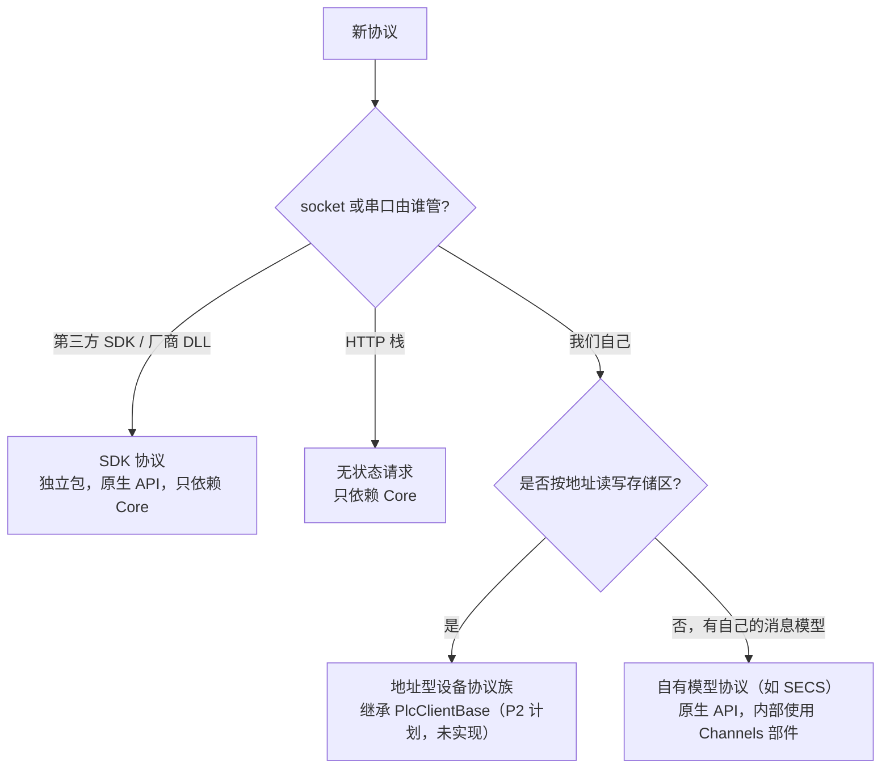
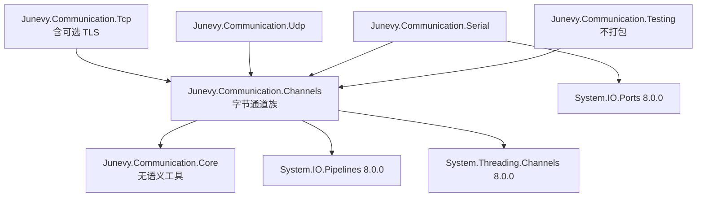

# 通讯库总体架构（协议族）

<cite>
**本文引用的文件**
- [docs/superpowers/specs/2026-10-10-communication-core-design.md](file://docs/superpowers/specs/2026-10-10-communication-core-design.md)
- [docs/superpowers/plans/2026-10-10-p1-communication-channels.md](file://docs/superpowers/plans/2026-10-10-p1-communication-channels.md)
- [build/Junevy.Communication.Common.props](file://build/Junevy.Communication.Common.props)
- [build/Junevy.Communication.Tests.props](file://build/Junevy.Communication.Tests.props)
- [Junevy.Communication.Core/Junevy.Communication.Core.csproj](file://Junevy.Communication.Core/Junevy.Communication.Core.csproj)
- [Junevy.Communication.Channels/Junevy.Communication.Channels.csproj](file://Junevy.Communication.Channels/Junevy.Communication.Channels.csproj)
- [Junevy.Communication.Tcp/Junevy.Communication.Tcp.csproj](file://Junevy.Communication.Tcp/Junevy.Communication.Tcp.csproj)
- [Junevy.Communication.Udp/Junevy.Communication.Udp.csproj](file://Junevy.Communication.Udp/Junevy.Communication.Udp.csproj)
- [Junevy.Communication.Serial/Junevy.Communication.Serial.csproj](file://Junevy.Communication.Serial/Junevy.Communication.Serial.csproj)
- [Tests/Junevy.Communication.Testing/Junevy.Communication.Testing.csproj](file://Tests/Junevy.Communication.Testing/Junevy.Communication.Testing.csproj)
- [Junevy.Communication.Modbus/Junevy.Communication.Modbus.csproj](file://Junevy.Communication.Modbus/Junevy.Communication.Modbus.csproj)
</cite>

## 目录
1. [协议族划分](#协议族划分)
2. [共享实现，不共享语义](#共享实现不共享语义)
3. [新协议归类指引](#新协议归类指引)
4. [包依赖规则](#包依赖规则)
5. [与 Modbus 的关系](#与-modbus-的关系)
6. [分期与当前状态](#分期与当前状态)

## 协议族划分

通讯库按**协议族**组织。族内共享接口与骨架，新协议继承骨架、只写协议差异；族间只共享没有语义的工具（结果分类、退避、命名注册表、超时工具、十六进制格式化）。

| 协议族 | 成员 | 族内共享什么 | 对外 API | 状态 |
|---|---|---|---|---|
| 字节通道族 | TCP（含可选 TLS）、UDP、串口 | 连接生命周期、分帧、请求-应答关联、心跳、重连、超时 | `IClientChannel` / `IByteChannel`（以及 `TcpServer` 的会话） | P1 已实现 |
| 地址型设备协议族 | MELSEC MC、S7、欧姆龙 FINS、Modbus（v3，P7 已迁移） | 请求管线、类型化读写、地址解析、拆包、字节序；建立在字节通道族之上 | `IPlcClient` 与类型化扩展方法（`Junevy.Communication.Plc`） | P2 已实现（Plc 套件 + MELSEC MC）；S7、FINS 为设计，P4 |
| SECS | HSMS、GEM（不做 SECS-I） | 内部复用字节通道族的实现 | 原生 SECS-II 消息、HSMS 与 GEM 状态 | 设计，P5 |
| SDK 协议 | OPC UA、MQTT、FTP、厂商 DLL | 只使用 Core 工具 | 原生语义，用本库的薄类型表达，不暴露 SDK 类型；只面向 net8.0 | 计划已写，P6（见 [[变更与决策/设计决策记录]]"SDK 协议适配"） |
| 无状态请求 | WebAPI（REST、SOAP）、HTTP 服务端 | 只使用 Core 工具 | 原生 HTTP 语义（`WebApiResult<T>`） | 设计，P3 |

> [!note] 本期实现范围
> P1 只实现 **Core** 与 **字节通道族**（Channels、Tcp、Udp、Serial）以及测试套件 `Junevy.Communication.Testing` 的 P1 部分。表中其余族只是设计，仓库中没有对应的项目。

> [!note] P2 实现范围
> P2 增加了地址型设备协议族的两个项目：`Junevy.Communication.Plc`（协议套件）与 `Junevy.Communication.Melsec`（MELSEC MC）。见 [[架构设计/Plc 地址型设备协议套件]] 与 [[协议细节/MELSEC MC 协议]]。SECS、SDK 协议与 WebAPI 仍只是设计。

PROFINET 的归类也写在设计文档中：PROFINET IO 本身归入"SDK 协议"（需要专用协议栈或通讯卡）；通过 PROFINET 网口读写西门子 PLC 时实际走的是 S7 协议，归入"地址型设备协议族"。

## 共享实现，不共享语义

第一轮设计让所有协议实现同一个顶层接口（统一的生命周期接口、统一的 `ConnectionState`、统一的工厂）。第二轮审阅否决了这一做法，原因是强行统一会压扁各协议的真实语义：

- SECS 的"已连接"要区分 Not Selected 与 Selected，GEM 还有通讯状态与控制状态；
- OPC UA 有会话、订阅和逐项状态码，按地址读写没有意义；
- WebAPI 根本没有连接。

因此实现采用以下规则：

1. **`IConnectable` 只用于"拥有一条字节链路"的对象**（字节通道与地址型客户端）。它的 `State` 只回答"底层链路是否可用"。SECS、OPC UA 等保留原生状态模型。
2. **不提供跨族统一工厂**。字节通道族的工厂是 `ChannelFactory`，地址型族计划为 `PlcClientFactory`，两者都建立在 Core 的 `NamedRegistry<T>` 之上。宿主若要"一份配置声明所有设备"，在宿主层把自己的设备模型映射到各族工厂，这是宿主的领域模型，不由通讯库规定。
3. **协议与传输分离**。协议客户端持有一条字节通道，而不是继承 socket；同一套协议代码可以挂在 TCP、UDP 或串口上（设计目标，P2 起验证）。
4. **组合优于继承**。通道层用可组合部件（监督器、流通道、分帧器、探测器、策略）；协议族内部才使用模板方法基类。

## 新协议归类指引

归类后的具体要求：

- **SDK 协议**：独立包，原生 API，依赖只限 Core 与对应的第三方 SDK。第三方包只允许出现在这类适配包中。
- **无状态请求**：只依赖 Core，不被带上 Pipelines 与通道机制。
- **地址型协议**：继承计划中的 `PlcClientBase`，只写地址表、帧和错误码；请求管线、重试、类型化读写由套件提供。
- **自有消息模型协议**：原生 API，内部复用 Channels 的分帧、关联与心跳部件（SECS 的 HSMS 即如此设计）。

## 包依赖规则

下表依据各项目的 csproj 与打包后的 nuspec（`1.0.0-preview.1`）核对：

| 包 | 项目引用 | 包依赖（csproj） | 打包后的依赖（nuspec） | 阶段 |
|---|---|---|---|---|
| `Junevy.Communication.Core` | 无 | `Microsoft.Extensions.DependencyInjection.Abstractions` 8.0.0、`Microsoft.Extensions.Logging.Abstractions` 8.0.0；net472 另加 `Microsoft.Bcl.AsyncInterfaces` 8.0.0、`System.Memory` 4.5.5（条件化，20.1 第 41 项） | net8.0：两个 Abstractions；net472：四个包。**不含** Pipelines 与 Channels | P1 |
| `Junevy.Communication.Channels` | Core | `System.IO.Pipelines` 8.0.0（两个目标）；`System.Threading.Channels` 8.0.0（仅 net472） | net8.0：Core + Pipelines；net472：Core + 上述两个包 | P1 |
| `Junevy.Communication.Tcp` | Channels | 无 | Channels | P1 |
| `Junevy.Communication.Udp` | Channels | 无 | Channels | P1 |
| `Junevy.Communication.Serial` | Channels | `System.IO.Ports` 8.0.0 | Channels + `System.IO.Ports` 8.0.0 | P1 |
| `Junevy.Communication.Testing` | Channels | 无（`IsPackable=false`） | 不打包 | P1 起扩充 |

依赖规则（设计文档第 3.1 节与第 21.1 节 Q3、R1）：

1. **只向下依赖**；同层协议包之间互不引用。
2. **Core 无语义，不依赖 Pipelines 与 Channels**（R1）。WebApi、OPC UA 等只依赖 Core 的协议包因此不会被带上通道机制。
3. **允许微软一方的 BCL 扩展包**（Pipelines、Channels、System.Text.Json），**第三方包只允许出现在 SDK 适配包中**（Q3）。这一条放宽了 Modbus 库"不新增外部包依赖"的 2026-10-05 约束，该约束只适用于 Modbus。
4. **传输包只依赖 Channels**。协议包直接引用自己支持的传输包（例如 MELSEC 引用 Tcp、Udp、Serial），用户无需自己组装。
5. **内部可见性**：Channels 对第一方传输包开放 `internal`（`InternalsVisibleTo` 指向 `Junevy.Communication.Tcp`、`Junevy.Communication.Udp` 以及自己的测试项目）；Serial 不开放，只使用公开基类。**第三方传输只能使用公开基类 `StreamClientChannel`**（D12）。
6. **统一版本发布**：所有通道族包由 `build/Junevy.Communication.Common.props` 统一设置为 `1.0.0-preview.1`（D1）。

## 与 Modbus 的关系

- **P7 已把 Modbus 迁移到 Plc 套件**（`Junevy.Communication.Modbus` 3.0.0-preview.1，破坏性，原地替换；设计第 20.12 节）。Modbus 成为地址型协议套件的第三个使用者，与 MELSEC、S7、FINS 一样走 `PlcClientBase` 与通道族。
- TCP 走 `TcpClientChannel` + LengthField 分帧 + 按事务号的 `Keyed` 关联；RTU 走 `SerialChannel` 或 RTU over TCP（协议声明的 RTU 分帧）；Modbus over UDP 按数据报分帧。地址写法为 `HR100` 与一基写法 `40101`，站号前缀 `s=n;`（设计第 17 节，P7-D4）。
- 与通道族其他协议的差异已经消失：Modbus 也是后台重连、只有异步 API、`CS1591` 不抑制（见 [[行为契约/通道重连心跳与超时]] 中的"Modbus 与其他协议的重连"一节）。2.x 的同步与异步双轨、懒重连与 `CS1591` 抑制已移除。
- 新协议仍然按 [[Agent协作/新增协议指南]] 设计；Modbus 迁移的过程与摩擦记录见计划 `2026-10-19-p7-modbus-migration.md`。

## 分期与当前状态

| 阶段 | 内容 | 状态（本页回写时） |
|---|---|---|
| P1 | Core、Channels、Tcp（含可选 TLS）、Udp、Serial、测试套件的 P1 部分 | 已完成（计划第 20 节有 Task 16 的最终验收：连续三次全量回归一致、依赖检查、扩展性预演通过，2026-10-10，`dc1e6e5`） |
| P2 | Plc 套件 + MELSEC MC（用真实协议验证扩展性，设计 R2） | 已完成（计划第 20.3 节记录最终验收与度量：连续三次全量测试一致，Melsec 生产代码 1304 有效行）。MELSEC 未经真机验证（P2-D16） |
| P3 | WebApi（REST 客户端、SOAP 客户端、HTTP 服务端） | **P3.1 客户端（REST + SOAP）已完成**（计划 `2026-10-11-p31-webapi-client.md`），见 [[WebApi/WebApi 客户端与钩子]]。**P3.2 HTTP 服务端已完成**（计划 `2026-10-17-p32-webapi-server.md`，独立包 `Junevy.Communication.WebApi.Server`，嵌入式 Kestrel，只面向 net8；见 [[WebApi/WebApi 服务端]]）；3.1 客户端包本期零改动。离线缓存只预留了前提。全部待办见 [[项目概述/待办与路线图]] |
| P4 | S7、FINS（套件的第二、第三个使用者） | 已完成（计划 `2026-10-12-p4-s7-fins.md`；随后的 P4.5 协议共用件、P4.6 测试基建也已完成）。S7、FINS 未经真机验证 |
| P5 | SECS 设备端：P5.1 SECS-II + HSMS-SS → P5.2 GEM。不做 SECS-I（2026-10-13 用户决定） | **P5.1 已完成**（计划 `docs/superpowers/plans/2026-10-12-p51-secs-hsms.md`，验收记录见第 20.1 节；2026-10-14 合入 master）。设计修订见设计文档第 20.7 节。P5.2 GEM 未开始，开工前的问题见 [[协议细节/P5.2 GEM（待办）]] |
| P6 | SDK 协议客户端（只面向 net8.0）：P6.1 MQTT → P6.2 OPC UA → P6.3 FTP | **P6.1 MQTT、P6.2 OPC UA、P6.3 FTP 均已完成**（P6.1 于 2026-10-14、P6.2 于 2026-10-17、P6.3 于 2026-10-18 合入 master；验收记录分别见 P6.2 计划第 19.1 节与 P6.3 计划第 18.1 节）。设计修订见 `docs/superpowers/specs/2026-10-10-communication-core-design.md` 第 20.8、20.9、20.11 节；实测摩擦分别见 `2026-10-12-p61-mqtt.md` 第 18.2 节 F1–F13 与 `2026-10-12-p62-opcua.md` 第 19.2.13 节 F1–F33；FTP 见 `2026-10-12-p63-ftp.md` 第 18.2 节 F1–F31。三包都只做客户端、只引用 Core、SDK 类型只在 `Sdk/` 命名空间，FTP 按同一结构实现，架构守卫各加一行登记。三者都未经真实服务器验证（MQTT、OPC UA 只与进程内的官方实现联调过；FTP 只与自写的模拟服务器联调过） |
| P7 | Modbus 迁移到 Plc 套件（3.0.0-preview.1，破坏性，原地替换） | **已完成**（2026-10-19，分支 `feat/modbus-p7`，未发布）。计划 `2026-10-19-p7-modbus-migration.md`；设计修订见设计文档第 20.12 节。Modbus 未经真机验证（P7-D17） |

版本策略（D1）：通道族包以 `1.0.0-preview.1` 发布前的状态存在，**不执行 `nuget push`**。P2 用 MELSEC 验证扩展性之后才发布 `1.0.0`，因为验证中发现的通道层缺口可能需要调整公开 API。在此之前公开 API 可能变化。

## P2.5 扩展面（接缝整理）

- Core 新增公开的缓冲与工厂外壳：`ByteBufferWriter`、`ByteSequenceReader`、`IConfigTypedCreator`、`CreatorCatalog<TCreator>` 与 `NamedFactory<TItem>`；字节通道族与地址型族的工厂都派生 `NamedFactory<TItem>`。
- 传输由创建器声明特征（`IChannelCreator.Delivery`、`Medium`）；协议只提供 `Create(IChannelConfig …)`，经 `PlcChannelBinding` 创建通道。
- 生产程序集之间不新增 `InternalsVisibleTo`（P25-D2，由 `Architecture.Tests` 强制）。
- 详细说明见 [[架构设计/通道与协议的扩展面（P2.5）]]。
