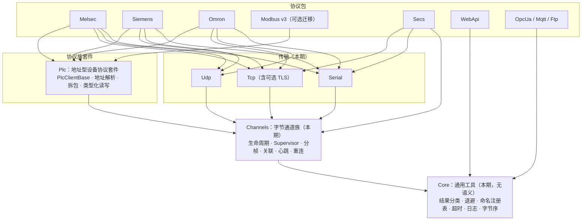
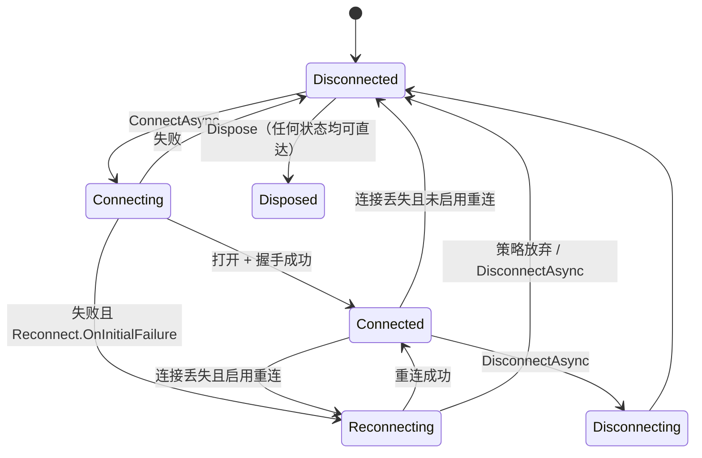
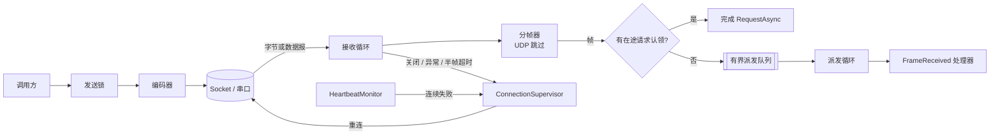

# 通讯库扩展架构设计

> 状态：第二轮审阅后重写（2026-10-10），**全部决策已确认**（第 21 节）；第 20 节记录审阅发现与改动。下一步按阶段编写实施计划 `docs/superpowers/plans/`。
> 日期：2026-10-10
> 本期范围（P1）：通用工具（Core）+ 字节通道族（Channels：TCP 客户端/服务端含可选 TLS、UDP、串口）+ 测试套件。
> 已规划：地址型设备协议套件 + MELSEC、WebAPI（MES）、S7、SECS/GEM、OPC UA / MQTT / FTP、Modbus 迁移（第 19 节）。

---

## 1. 核心判断：共享实现，不共享语义

设计目标是**扩展性**：以后新增一个协议（例如 MELSEC）时，能在现有基础上很快搭好主体。抽象程度本身不是目标。

第一轮设计试图让所有协议实现同一个顶层接口，第二轮审阅认为这是错的（详见第 20 节）：SECS 的"已连接"要区分 Not Selected 和 Selected，GEM 还有通讯状态与控制状态；OPC UA 有会话、订阅和逐项状态码；WebAPI 根本没有连接。强行统一只会把这些语义压扁。

因此改为**按协议族组织**：

- **族内**统一接口与骨架，新协议继承骨架、只写协议差异；
- **族间**只共享"没有语义的工具"（结果分类、退避算法、命名注册表、超时工具、日志、字节序）。

| 协议族 | 成员 | 族内共享什么 | 对外 API |
|---|---|---|---|
| **字节通道族** | TCP、TLS、UDP、串口 | 连接生命周期、分帧、请求-应答关联、心跳、重连、超时 | `IClientChannel` / `IByteChannel` |
| **地址型设备协议族** | MELSEC MC、S7、欧姆龙 FINS、Modbus（v3 迁移后） | 建立在字节通道族之上：请求管线、类型化读写、地址解析、拆包、字节序 | `IPlcClient` + 类型化扩展方法 |
| **SECS** | HSMS、GEM（不做 SECS-I，见 21.1 Q13） | **内部**复用字节通道族的实现 | 原生：SECS-II 消息、HSMS 状态、GEM 状态 |
| **SDK 协议** | OPC UA、MQTT、FTP、厂商 DLL | 只用 Core 工具 | 原生：保留各 SDK 的模型 |
| **无状态请求** | WebAPI（REST、SOAP）、HTTP 服务端 | 只用 Core 工具 | 原生：HTTP 语义 |

关于 PROFINET：PROFINET IO 本身是二层实时以太网，PC 端需要专用协议栈或通讯卡，归入"SDK 协议"；通过 PROFINET 网口读写西门子 PLC 数据，实际走的是 S7 协议（TCP 102 端口），归入"地址型设备协议族"。

### 1.1 新协议归类指引

```mermaid
flowchart TD
    N[新协议] --> Q1{socket 或串口由谁管?}
    Q1 -->|第三方 SDK / 厂商 DLL| C["SDK 协议<br/>独立包，原生 API<br/>只依赖 Core"]
    Q1 -->|HTTP 栈| D["无状态请求<br/>并入 WebApi 或独立包<br/>只依赖 Core"]
    Q1 -->|我们自己| Q2{是否"按地址读写存储区"?}
    Q2 -->|是| P["地址型设备协议族<br/>继承 PlcClientBase<br/>只写地址表、帧、错误码"]
    Q2 -->|否，有自己的消息模型| S["自有模型协议（如 SECS）<br/>原生 API<br/>内部使用 Channels 部件"]
```

---

## 2. 设计原则

1. **扩展性优先于抽象度**：衡量标准是"新增一个协议要写多少代码、要不要改公共代码"，不是"有多少协议实现了同一个接口"。
2. **族内统一，族间只共享工具**：只有语义真正一致的协议才共用接口；特殊协议保留原生模型。
3. **协议与传输分离**：协议客户端**持有**一条字节通道，而不是继承 socket。MELSEC 的 TCP、UDP、串口三种接法共用一套 MC 协议代码。
4. **组合优于继承，骨架用模板方法**：通道层用可组合部件（Supervisor、StreamChannel、分帧器、探测器、策略）；协议族内部用模板方法基类（`PlcClientBase`），这与 Modbus 的 `ModbusTransportBase` 已验证的做法一致。
5. **依赖隔离**：每种传输、每个协议一个包；第三方 SDK 只出现在各自的适配包里；特殊协议族不依赖通道机制。
6. **沿用 Modbus 已验证的契约**：失败一律走结果对象，编程错误抛标准异常；Dispose 契约、超时与取消的区分、net472 的"取消时销毁 socket"降级手法、重试规则 A–F 的语义都直接继承。
7. **配置可序列化**：`XxxConfig` / `XxxOptions` 只含 POCO 字段，可以直接从 JSON 加载；自定义策略对象、证书对象通过代码注入。
8. **双目标 net472 + net8.0**；新模块只提供异步 API（Q2）。

---

## 3. 分层与程序集



### 3.1 程序集（NuGet 包）

| 程序集                                             | 内容                                                                                  | 依赖                                                                                                          | 阶段       |
| ----------------------------------------------- | ----------------------------------------------------------------------------------- | ----------------------------------------------------------------------------------------------------------- | -------- |
| `Junevy.Communication.Core`                     | 通用工具：`CommResult` / `CommErrorKind`、退避与重试循环、`NamedRegistry<T>`、超时工具、日志工具、字节序转换      | `Microsoft.Extensions.*.Abstractions`；net472 另加 `System.Memory`、`Microsoft.Bcl.AsyncInterfaces`（net8.0 已内置） | P1       |
| `Junevy.Communication.Channels`                 | 字节通道族：接口、状态机、Supervisor、StreamChannel、DatagramChannel、分帧器、关联、心跳、重连、`ChannelFactory` | Core + `System.IO.Pipelines`（net472 另加 `System.Threading.Channels`）                                         | P1       |
| `Junevy.Communication.Tcp`                      | `TcpClientChannel`、`TcpServer`、`TcpSession`、可选 TLS                                  | Channels                                                                                                    | P1       |
| `Junevy.Communication.Udp`                      | `UdpChannel`（定向 / 非定向、广播、组播）                                                        | Channels                                                                                                    | P1       |
| `Junevy.Communication.Serial`                   | `SerialChannel`                                                                     | Channels + System.IO.Ports                                                                                  | P1       |
| `Junevy.Communication.Plc`                      | 地址型设备协议套件                                                                           | Channels                                                                                                    | P2       |
| `Junevy.Communication.Melsec`                   | 三菱 MC 协议                                                                            | Plc + Tcp + Udp + Serial                                                                                    | P2       |
| `Junevy.Communication.WebApi`                   | REST 客户端、SOAP 客户端、HTTP 服务端                                                          | Core + System.Text.Json                                                                                     | P3       |
| `Junevy.Communication.Siemens` / `.Omron`       | S7、FINS                                                                             | Plc + 所需传输包                                                                                                 | P4       |
| `Junevy.Communication.Secs`                     | SECS-II、HSMS-SS（设备端），之后是 GEM；不做 SECS-I                                       | Channels + Tcp                                                                                              | P5       |
| `Junevy.Communication.Mqtt` / `.OpcUa` / `.Ftp` | SDK 适配：只做客户端，**只面向 net8.0**（Q9–Q12）                                                 | Core + 对应第三方 SDK（MQTTnet 5、OPC Foundation .NET Standard 2.0、FluentFTP）                                           | P6       |
| `Junevy.Communication.Modbus`                   | 现有，本期不动                                                                             | 现状                                                                                                          | P7 可选迁移  |
| `Junevy.Communication.Testing`                  | 测试套件（内部共享测试工程，暂不发布）                                                                 | Channels                                                                                                    | P1 起持续扩充 |

**依赖规则**：
- 只允许向下依赖；同层协议包之间互不引用。
- 只有字节通道族及其上层（Plc、Secs、PLC 协议）依赖 Channels；WebApi、OpcUa、Mqtt、Ftp 只依赖 Core，不会被带上 Pipelines 和通道机制。
- 协议包直接引用自己支持的传输包（例如 Melsec 引用 Tcp、Udp、Serial），用户不需要自己组装。
- 第三方包只允许出现在 SDK 适配包中（Q3）。
- SDK 适配包的公开 API 不出现 SDK 的类型；包内凡是使用 SDK 的代码都集中在 `Sdk` 命名空间（Q11）。

### 3.2 仓库目录

```
Junevy.Communication.Core/
  Results/        CommResult, CommResult<T>, CommErrorKind
  Resilience/     IBackoffPolicy, FixedIntervalBackoff, ExponentialBackoff, RetryLoop
  Registry/       NamedRegistry<T>（命名 + 别名 + 安全释放）
  Buffers/        ByteTransform, WordOrder（ABCD/BADC/CDAB/DCBA）, 字符串编解码
  Diagnostics/    十六进制格式化、敏感信息脱敏
  Utils/          TimeoutScope（链接 CTS + 超时/取消判别 + net472 销毁中止）
Junevy.Communication.Channels/
  Abstractions/   IConnectable, IClientChannel, IByteChannel, IFrameDecoder, IFlushableFrameDecoder, IFrameEncoder,
                  IFrameCodecFactory, IResponseMatcher, IFrameKeyExtractor, IHealthProbe, IConnectionInitializer,
                  IChannelConfig, IChannelCreator
  Models/         ConnectionState, DisconnectReason, ConnectionStateChangedEventArgs, FrameReceivedEventArgs,
                  ConnectionStatistics, RequestOptions
  Options/        FramingOptions, HeartbeatOptions, ReconnectOptions, ChannelComponents
  Lifecycle/      ConnectionSupervisor (internal), HeartbeatMonitor (internal)
  Framing/        Raw / Delimiter / FixedLength / LengthField / StartEnd / IdleGap
  Pipeline/       FrameRouter, StreamChannel, DatagramChannel, PendingRequestTable (internal)
  Factory/        ChannelFactory
  DependencyInjection/
Junevy.Communication.Tcp/       Client/  Server/  Tls/  Options/  DependencyInjection/
Junevy.Communication.Udp/
Junevy.Communication.Serial/
Tests/                          （测试项目统一放在物理目录 Tests/ 下，解决方案中归入同名解决方案文件夹，2026-10-11 起）
  Junevy.Communication.Testing/   （测试套件，见第 13 节）
  Junevy.Communication.Core.Tests/  .Channels.Tests/  .Tcp.Tests/  .Udp.Tests/  .Serial.Tests/
  Junevy.Communication.Modbus.Tests/
```

---

## 4. Core：通用工具（无语义）

Core 只放"任何协议拿去用都不会被扭曲语义"的东西。

| 工具 | 作用 | 谁会用 |
|---|---|---|
| `CommResult` / `CommResult<T>` / `CommErrorKind` | 粗粒度的结果分类，供宿主统一告警和重试决策 | 字节通道族、地址型协议族直接使用；特殊协议在自己的结果类型里附带一个 `ErrorKind` 字段 |
| `IBackoffPolicy` + `RetryLoop` | 固定间隔 / 指数退避（带抖动）的纯计算，以及"按策略重试直到成功或放弃"的循环 | 通道重连、MQTT 重连、WebApi 重试 |
| `NamedRegistry<T>` | 命名实例 + 别名 + 并发安全 + 移除时释放；沿用 `ModbusConnectionManager` 已修复的规则 | 各族自己的工厂 |
| `TimeoutScope` | 链接 CTS + `CancelAfter`；区分"超时"和"用户取消"；net472 上超时时销毁底层对象 | 全部 |
| `ByteTransform` / `WordOrder` | 整数、浮点、字符串与字节的互转，支持 ABCD/BADC/CDAB/DCBA | 地址型协议族、SECS-II、自定义协议 |
| 十六进制格式化、脱敏 | TX/RX 日志、敏感头脱敏 | 全部 |

```csharp
public enum CommErrorKind
{
    // 0–7 与 ModbusErrorKind 数值一一对应，未来 Modbus 迁移时可直接映射
    None = 0,
    Unspecified = 1,
    InvalidRequest = 2,
    ConnectionClosed = 3,      // 操作过程中连接断开 / 发送失败
    Timeout = 4,
    ProtocolViolation = 5,     // 帧格式、长度、校验、关联键不符、反序列化失败
    RemoteError = 6,           // 对端返回的协议级错误（Modbus 异常码、MC 结束码、S7 错误码、HTTP 4xx/5xx …）
    Cancelled = 7,
    NotConnected = 8,          // 操作开始时就未连接
    AuthenticationFailed = 9,  // TLS 证书校验失败、登录失败
    ResourceExhausted = 10,    // 会话数已满、队列已满
    NotSupported = 11,
}

public sealed class CommResult
{
    public bool IsSuccess { get; }
    public CommErrorKind ErrorKind { get; }
    public string? ErrorMessage { get; }
    public long? ProtocolErrorCode { get; }   // 协议原始错误码，如 MC 结束码 0xC051
    public Exception? Exception { get; }      // 仅供诊断，不参与决策
}
public sealed class CommResult<T> { /* 同上 + T? Data */ }
```

`CommErrorKind` 是**粗分类**，不承载协议的完整错误语义。规则沿用 Modbus：`Fail(..., None)` 抛 `ArgumentException`；决策只看 `ErrorKind`，不匹配消息字符串；`ErrorKind` 逐层透传。

---

## 5. Channels：字节通道族

### 5.1 接口

```csharp
/// 拥有一条字节链路的对象的链路状态。通道和地址型协议客户端都实现它，语义都是"底层链路是否可用"。
public interface IConnectable
{
    string Name { get; }
    ConnectionState State { get; }
    bool IsConnected { get; }
    ConnectionStatistics Statistics { get; }
    event EventHandler<ConnectionStateChangedEventArgs>? StateChanged;

    /// 失败返回 Fail；用户取消抛 OperationCanceledException（与 IModbus.ConnectAsync 一致）。
    Task<CommResult> ConnectAsync(CancellationToken cancellationToken = default);
    /// 用户主动断开：停止后台重连，此后不会自动连回。
    Task DisconnectAsync(CancellationToken cancellationToken = default);
    /// 等待进入 Connected；超时返回 false。
    Task<bool> WaitForConnectedAsync(int timeout, CancellationToken cancellationToken = default);
}

/// 字节收发能力。TCP 客户端、TCP 服务端会话、UDP、串口都实现它。
/// 不声明 IsConnected：链路状态属于 IConnectable；两处同时声明会让 IClientChannel 上的访问产生歧义（CS0229）。
public interface IByteChannel
{
    Task<CommResult> SendAsync(ReadOnlyMemory<byte> payload, CancellationToken cancellationToken = default);
    Task<CommResult<byte[]>> RequestAsync(ReadOnlyMemory<byte> payload, RequestOptions? options = null, CancellationToken cancellationToken = default);
    /// 不发送，只等待下一个匹配帧（例如等设备主动上报 "READY"）。
    Task<CommResult<byte[]>> ReceiveAsync(RequestOptions? options = null, CancellationToken cancellationToken = default);
    /// 未被 RequestAsync / ReceiveAsync 认领的入站帧。
    event EventHandler<FrameReceivedEventArgs>? FrameReceived;
}

/// 主动发起连接的通道：TcpClientChannel、UdpChannel、SerialChannel。
public interface IClientChannel : IConnectable, IByteChannel, IDisposable, IAsyncDisposable
{
}

public enum ConnectionState { Disconnected, Connecting, Connected, Reconnecting, Disconnecting, Disposed }

public enum DisconnectReason
{
    None, UserRequested, RemoteClosed, SendFailed, RequestTimeout, HeartbeatFailed, IdleTimeout,
    PartialFrameTimeout, ProtocolViolation, AuthenticationFailed, ReconnectExhausted, Error, Disposed,
}

public sealed class RequestOptions
{
    public int? Timeout { get; set; }               // null → Config.RequestTimeout
    public IResponseMatcher? Matcher { get; set; }  // null → 按 CorrelationMode 的默认规则
}

public sealed class FrameReceivedEventArgs : EventArgs
{
    public byte[] Data { get; }                     // 独立副本，调用方可以随意持有
    public DateTimeOffset ReceivedAt { get; }
    public EndPoint? RemoteEndPoint { get; }        // UDP 下为来源地址（定向与非定向模式都携带）；其余为 null
}
```

"已连接"在三种传输上的含义：TCP = 握手（及 TLS、初始化）完成；串口 = 端口已打开；UDP = socket 已绑定。串口和 UDP 本身无法感知对端是否在线，**必须配合心跳或空闲超时才能发现对端掉线**。

文本协议（扫码枪、视觉、机器人）用扩展方法（`ByteChannelTextExtensions`）：`SendTextAsync(string, Encoding?)`、`RequestTextAsync(...)`、`ReceiveTextAsync(...)`，适用于任何 `IByteChannel`。默认编码 UTF-8（无 BOM）；不追加分隔符，分隔符由 Delimiter 编码器的 `AppendDelimiterOnSend` 负责（20.1 第 1 项）。

状态机：



### 5.2 分帧

TCP 和串口是字节流，没有消息边界，必须分帧（处理粘包和半包）。UDP 的数据报天然有边界，不经过分帧器。

```csharp
/// 每条连接一个实例（分帧器可以有内部状态）。
public interface IFrameDecoder
{
    /// 从缓冲区切出一帧：成功时 buffer 前移并返回 true；数据不足返回 false。
    /// 数据非法时抛 FrameDecodeException → 归类 ProtocolViolation。
    bool TryDecode(ref ReadOnlySequence<byte> buffer, out ReadOnlySequence<byte> frame);
}

/// 按"静默时间"判定帧结束：输入停顿 FlushTimeout 毫秒后，接收循环调用 TryFlush 交出残余数据。
public interface IFlushableFrameDecoder : IFrameDecoder
{
    int FlushTimeout { get; }
    bool TryFlush(ref ReadOnlySequence<byte> buffer, out ReadOnlySequence<byte> frame);
}

public interface IFrameEncoder { void Encode(ReadOnlySpan<byte> payload, IBufferWriter<byte> output); }
public interface IFrameCodecFactory { IFrameDecoder CreateDecoder(); IFrameEncoder CreateEncoder(); }
```

分帧器直接在 Pipelines 的缓冲上切帧，不额外复制；静默超时通过内部 `Pipe` 读端的 `CancelPendingRead()` 实现（为什么不直接对流使用 `PipeReader`，见 6.2）。

| Mode | 参数 | 典型场景 |
|---|---|---|
| `Raw` | — | 每次读到的数据块就是一帧（调试抓包）。串口一次读取常常只返回半帧，**串口不要用 Raw** |
| `Delimiter` | 分隔符（可多个，支持 `\r\n` 转义或十六进制）、是否保留分隔符 | 扫码枪、视觉、ASCII 指令 |
| `FixedLength` | 帧长 | 定长报文 |
| `LengthField` | 长度字段偏移、宽度、**编码（二进制大端 / 二进制小端 / ASCII 十六进制 / ASCII 十进制）**、长度修正值、剥离字节数 | Modbus TCP、S7、MELSEC（二进制与 ASCII）、HSMS、自定义协议 |
| `StartEnd` | 起始符、结束符 | STX…ETX；遇到垃圾字节自动重新同步 |
| `IdleGap` | 静默时间 `GapTimeout`（毫秒） | 没有分隔符也没有长度字段的串口设备；**串口默认值** |

所有分帧器受 `MaxFrameLength` 约束（默认 64 KiB）。计量口径（20.1）：`Delimiter` 按分隔符之前的内容计量（`KeepDelimiter=true` 时交付的帧最长为上限加分隔符长度）；`IdleGap` 只在缓冲超过上限时抛出；其余分帧器按线路上的整帧计量。`Delimiter` 跳过连续分隔符之间的空帧；发送时编码器默认追加 `Delimiters[0]`（`FramingOptions.AppendDelimiterOnSend`，D18）。

**用远期协议验证 `LengthField`**（帧总长 = 偏移 + 字段宽度 + 长度值 + 修正值）：

| 协议 | 长度字段 | LengthField 参数 |
|---|---|---|
| Modbus TCP | 第 4–5 字节，大端，计其后字节数 | offset=4, size=2, BinaryBE, adjust=0 |
| S7（TPKT/RFC1006） | 第 2–3 字节，大端，含 4 字节头的总长 | offset=2, size=2, BinaryBE, adjust=-4 |
| MELSEC 3E 二进制响应 | 第 7–8 字节，小端 | offset=7, size=2, BinaryLE, adjust=0 |
| MELSEC 3E ASCII 响应 | 第 14–17 字符，4 位十六进制 | offset=14, size=4, AsciiHex, adjust=0 |
| MELSEC 4E 二进制响应 | 第 11–12 字节，小端 | offset=11, size=2, BinaryLE, adjust=0 |
| SECS HSMS | 第 0–3 字节，大端 | offset=0, size=4, BinaryBE, adjust=0 |

### 5.3 请求-应答关联

| `CorrelationMode` | 规则 | 适用 |
|---|---|---|
| `Sequential`（默认） | 同一时刻至多一个在途请求；在途期间到达的下一帧即为应答 | 绝大多数一问一答设备，MC 3E |
| `Matcher` | 允许多个在途请求；每个入站帧按 FIFO 交给在途请求的 `IResponseMatcher` 判定 | 主动上报与应答混发的设备 |
| `Keyed` | `IFrameKeyExtractor` 从请求和应答中各取一个键做字典匹配 | Modbus TCP 的 TID、MC 4E 的序列号、S7 的 PDU 引用号、HSMS 的 System Bytes |

```csharp
public interface IResponseMatcher { bool IsMatch(ReadOnlySpan<byte> request, ReadOnlySpan<byte> frame); }
public interface IFrameKeyExtractor
{
    bool TryGetRequestKey(ReadOnlySpan<byte> request, out long key);
    bool TryGetResponseKey(ReadOnlySpan<byte> frame, out long key);
}
```

- 入站帧的处理顺序：在途的 `RequestAsync` 认领 → 迟到应答判定（是则丢弃）→ `ReceiveAsync` 等待者认领 → `FrameReceived` 事件队列。应答**不经过**事件队列，慢的事件处理器不会拖慢请求（队列满且为 `Wait` 模式时，背压会让解析暂停，此时应答也会等待）。连接停止时，已进入事件队列的帧在 `DisconnectTimeout` 内继续派发完。
- 请求超时后的迟到应答：TCP `Sequential` 默认 `ResetOnRequestTimeout = true`（超时即断开重建，与 Modbus TCP 规则 C 同理），关闭重建时与串口、UDP 一样丢弃超时后 `LateReplyWindow` 内到达的帧，并在窗口期内继续持有请求锁（不让下一个请求在窗口期内发出并误认迟到应答）；`Keyed` 保留连接，超时的键在 `LateReplyWindow` 内被记录，同键的迟到应答记 Warning 后丢弃（不当作主动上报派发，避免宿主误当成新消息）；`Matcher` 无法识别迟到应答，按未认领帧派发。
- `Keyed` 模式下 `RequestAsync` 忽略 `RequestOptions.Matcher`（按关联键匹配），`ReceiveAsync` 在所有模式下使用 Matcher（接收等待者没有关联键）（20.1）。
- 用户取消等待应答与超时同样处理（D10）：TCP 默认因此断开重建；用户取消正在写出的帧同样断开连接（可能已写出半帧）。

### 5.4 心跳（三层保活）

| 层 | 机制 | 能发现什么 | 适用 |
|---|---|---|---|
| 操作系统 | TCP KeepAlive | 对端掉电、网线断开导致的半开连接 | TCP |
| 应用 | 心跳探测 `IHealthProbe` | 对端进程卡死；或链路无法感知对端（串口、UDP） | 全部 |
| 被动 | 空闲超时 `IdleTimeout` | 一段时间内没有任何入站数据 | 全部 |

```csharp
/// 原始通道 = 发心跳包（可选等应答）；协议可替换为自己的探测：MC = 回环测试 0619，S7 = 读 SZL，HSMS = Linktest。
/// 探测期间发出的请求超时不会触发 ResetOnRequestTimeout，失败按 MaxFailures 计数（否则第一次探测超时就会断开连接）；
/// 探测期间若什么都没发出（例如一直在等请求锁），本次视为跳过，不计失败。
public interface IHealthProbe { Task<CommResult> ProbeAsync(CancellationToken cancellationToken); }

public sealed class HeartbeatOptions
{
    public bool Enabled { get; set; }
    public int Interval { get; set; } = 5000;
    public int Timeout { get; set; } = 2000;
    public int MaxFailures { get; set; } = 3;
    public bool OnlyWhenIdle { get; set; } = true;
    public string? Payload { get; set; }             // 内置探测的心跳内容（文本，或以 hex: 开头）
    public string? ExpectedReply { get; set; }       // 为空：发送成功即健康（仅 TCP 允许）；非空：必须收到匹配应答
}
```

UDP 发送与串口写入几乎总是成功，"发送成功即健康"检测不到对端沉默，因此 UDP 与串口启用内置心跳时必须配置 `ExpectedReply`（或提供自定义 `IHealthProbe` / `HealthProbeFactory`），否则构造时抛 `ArgumentException`。

内置探测的其他约束（20.1）：未提供 `IHealthProbe` 也未提供 `HealthProbeFactory` 时必须有 `Heartbeat.Payload`，否则构造时抛出 `ArgumentException`；UDP 非定向模式启用内置心跳必须提供 `IHealthProbe` 或 `HealthProbeFactory`（内置探测发往远端）。心跳检测时间：首次探测在心跳启动后一个 `Interval` 才发出，之后按 `Interval` 起始到起始调度，对端开始沉默后第 `MaxFailures` 次失败约在 `(MaxFailures − 1) × Interval + Timeout` 之后判定（`Timeout` 大于 `Interval` 时探测间隔随之拉长，公式不再成立）；`OnlyWhenIdle` 为真时，两次判定之间有收发流量则跳过本次探测；探测因通道忙未写出任何帧时不计失败，`NotConnected` 的探测结果也不计。

### 5.5 重连

```csharp
public sealed class ReconnectOptions
{
    public bool Enabled { get; set; }                 // 默认 false，与 Modbus 的 Reconnect=false 一致
    public ReconnectMode Mode { get; set; } = ReconnectMode.ExponentialBackoff;
    public int Interval { get; set; } = 1000;
    public int MaxInterval { get; set; } = 30000;
    public int MaxAttempts { get; set; }              // 0 = 无限
    public bool OnInitialFailure { get; set; }        // 首次连接失败也转入后台重连（设备晚于软件上电、USB 串口未插）
}
```

退避计算使用 Core 的 `IBackoffPolicy`（带 ±20% 抖动）。"重连"在三种传输上分别是：TCP 重新握手；串口重新打开端口；UDP 重新绑定 socket。`ChannelComponents.ReconnectPolicy` 可覆盖由 `ReconnectOptions` 推导的退避策略，但重连仍受 `Reconnect.Enabled` 控制（20.1）。

### 5.6 握手钩子与组件注入

```csharp
/// 链路连通后、状态变为 Connected 之前执行；每次重连都会重新执行。
/// 服务端对每个新会话执行同一接口（例如 HSMS 被动端等待 Select.req 并应答）。
public interface IConnectionInitializer
{
    Task<CommResult> InitializeAsync(IByteChannel channel, CancellationToken cancellationToken);
}

/// 代码级覆盖：协议包通过它把自己的分帧、关联、握手、心跳交给通道；优先级高于 Config 中的同类设置。
public class ChannelComponents
{
    public IFrameCodecFactory? FrameCodec { get; set; }
    public CorrelationMode? Correlation { get; set; }
    public IFrameKeyExtractor? KeyExtractor { get; set; }
    public IConnectionInitializer? Initializer { get; set; }
    public IHealthProbe? HealthProbe { get; set; }                       // 与 HealthProbeFactory 互斥
    public Func<IByteChannel, IHealthProbe>? HealthProbeFactory { get; set; }   // 见下文
    public IBackoffPolicy? ReconnectPolicy { get; set; }
}
```

`ChannelComponents` 是协议族接入通道层的唯一入口：协议声明"我这样分帧、这样匹配应答、连上后这样握手、这样探活"，通道照做。

`HealthProbe` 与 `HealthProbeFactory` 互斥：同时设置时，任何通道或服务端的构造都抛出 `ArgumentException`（20.1）。工厂只在启用心跳时调用。客户端（TCP、UDP、串口）在第一次成功打开、启动心跳之前以通道自身为参数调用一次，结果在通道生命周期内复用（跨重连）；工厂抛出异常或返回 null 使本次打开失败（`Unspecified`），由重连策略处理。服务端在每个会话启动心跳时调用一次，参数为该会话（可转换为 `ITcpSession`）。工厂解决的问题是：探测需要引用通道，而通道在 `ChannelComponents` 构造之后才存在。

握手期间（`IConnectionInitializer` 执行中，以及服务端会话的握手）未被认领的入站帧进入积压缓冲（上限 64 帧，D8）：之后注册的 `ReceiveAsync` 先扫描积压，握手结束后积压按顺序转入派发队列；握手期间不派发 `FrameReceived`。积压溢出按 ProtocolViolation 处理（20.1）。

---

## 6. Channels 内部骨架

### 6.1 ConnectionSupervisor（internal）

- 驱动接口 `IConnectionDriver { OpenAsync(ct); CloseAsync(reason, drainTimeout); }`，TCP、UDP、串口各自实现。握手（TLS 包装与 `IConnectionInitializer`）在 `OpenAsync` 内、同一个握手时限内完成，不单独暴露 `InitializeAsync`；`CloseAsync` 的排空时限即 `DisconnectTimeout`（20.1）。
- 生命周期锁串行化 Connect、Disconnect、重连尝试；它与发送锁是两把锁，断线期间发送立即得到 `NotConnected`。
- `ReportConnectionLost(generation, reason, exception)` 可从任意线程调用。**连接代次**：每次连上加 1，旧代次的报告直接忽略，防止旧 socket 迟到的异常打断新连接。
- 状态事件经单消费者队列**按顺序**、在**锁外**触发，事件处理器里调用 `DisconnectAsync` 不会死锁。

### 6.2 FrameRouter / StreamChannel / DatagramChannel（internal）

- **FrameRouter**：两种通道共用的帧路由——`PendingRequestTable`（三种关联模式、超时、迟到应答）、有界派发队列（`Channel<T>`）、派发循环、`FrameReceived`、统计。
- **StreamChannel**：把 `Stream`（`NetworkStream`、`SslStream`、`SerialPort.BaseStream`）变成 `IByteChannel`。采用两个循环：**填充循环**从流读入内部 `Pipe`，**解析循环**从 `Pipe` 读出、分帧、复制、交给 FrameRouter。不直接对流使用 `PipeReader.Create(stream)`，因为 net472 的 `NetworkStream` 和 `SerialPort.BaseStream` 不响应取消令牌，`CancelPendingRead()` 打断不了挂起的流读取，静默分帧与半帧计时会失效；内部 `Pipe` 的读端则在两个目标上都可靠响应。缓冲区有未成帧数据时启动计时器（`IFlushableFrameDecoder` 到期交出残余；其他分帧器到 `PartialFrameTimeout` 时 TCP 断开、串口丢弃残余继续）；发送经发送锁和 `SendTimeout` 整帧写出，失败即报告 `SendFailed`。
- **DatagramChannel**：与具体传输无关（经内部的数据报传输接口收发，只有 Udp 包接触 `UdpClient`），每个数据报直接成为一帧；长度超过 `MaxDatagramSize` 的数据报计入 `ProtocolErrors` 统计并丢弃，不断开连接（`UdpClient` 总是返回完整数据报，无法检测截断）。语义与 StreamChannel 对齐：请求超时不重建连接（由迟到应答窗口处理）；发送失败仍按 11.1 报告 `SendFailed` 并断开（启用重连时重新绑定）（20.1）。
- TLS 只是把 `NetworkStream` 换成 `SslStream`，StreamChannel 不需要改动。

### 6.3 帧内存所有权

对外交付的帧一律是**复制出来的独立 `byte[]`**，不暴露池化缓冲。工业通讯通常每秒几十到几百帧，复制开销可以忽略，换来的是用户不可能写出"缓冲已归还但还在读"的 bug。

### 6.4 线程模型与背压



- 每条连接：接收端（字节流为填充循环与解析循环两个任务，数据报为一个接收循环）+ 1 个派发循环（异步任务，不占专用线程）+ 可选心跳（20.1）。
- 派发队列有界（默认 1024）。TCP 队列满时默认**等待**（暂停读取，由 TCP 流控让对端放慢）；串口和 UDP 没有流控，默认 `DropOldest` 并计数告警。
- 所有事件在线程池线程上触发，WPF 界面需自行切回 Dispatcher。

---

## 7. TCP（含可选 TLS）

`System.Net.Sockets.TcpClient` 已被 BCL 占用，因此客户端叫 `TcpClientChannel`，服务端叫 `TcpServer`，服务端的单个连接叫 `TcpSession`。配置类命名为"类名 + Config"。

### 7.1 TcpClientChannel

```csharp
public interface ITcpClientChannel : IClientChannel
{
    TcpClientChannelConfig Config { get; }
    IPEndPoint? RemoteEndPoint { get; }
    IPEndPoint? LocalEndPoint { get; }
    bool IsTlsActive { get; }
}

public sealed class TcpClientChannel : ITcpClientChannel
{
    public TcpClientChannel(TcpClientChannelConfig config, ILogger<TcpClientChannel>? logger = null, TcpChannelComponents? components = null);
}

public class TcpClientChannelConfig : IChannelConfig
{
    public string Host { get; set; } = "127.0.0.1";
    public int Port { get; set; }
    public string? LocalAddress { get; set; }        // 绑定本地网卡（多网卡工控机常用）
    public int LocalPort { get; set; }

    public int ConnectTimeout { get; set; } = 2000;
    public int HandshakeTimeout { get; set; } = 5000;     // TLS 握手 + IConnectionInitializer 的总时限
    public int SendTimeout { get; set; } = 2000;
    public int RequestTimeout { get; set; } = 2000;
    public int IdleTimeout { get; set; }
    public int PartialFrameTimeout { get; set; }
    public int DisconnectTimeout { get; set; } = 1000;

    public FramingOptions Framing { get; set; } = new();  // 默认 Raw；被协议包使用时由 ChannelComponents 覆盖
    public CorrelationMode Correlation { get; set; } = CorrelationMode.Sequential;
    public bool ResetOnRequestTimeout { get; set; } = true;
    public int LateReplyWindow { get; set; } = -1;               // ResetOnRequestTimeout = false 时生效；-1 = 等于 RequestTimeout
    public HeartbeatOptions Heartbeat { get; set; } = new();
    public ReconnectOptions Reconnect { get; set; } = new();
    public TcpSocketOptions Socket { get; set; } = new();        // NoDelay、KeepAlive、收发缓冲、Linger
    public TcpClientTlsOptions Tls { get; set; } = new();        // 默认关闭
    public int ReceiveQueueCapacity { get; set; } = 1024;
    public QueueFullMode QueueFullMode { get; set; } = QueueFullMode.Wait;
}
```

`Config` 返回构造时传入的对象本身（不是副本）；运行行为只依赖构造时的快照（20.1）。

### 7.2 TcpServer / TcpSession

```csharp
public interface ITcpServer : IDisposable, IAsyncDisposable
{
    string Name { get; }
    TcpServerConfig Config { get; }
    ServerState State { get; }                       // Stopped / Starting / Running / Stopping / Faulted
    IPEndPoint? LocalEndPoint { get; }
    int SessionCount { get; }
    IReadOnlyCollection<ITcpSession> Sessions { get; }

    event EventHandler<ServerStateChangedEventArgs>? StateChanged;
    event EventHandler<TcpSessionEventArgs>? SessionConnected;          // 握手完成后才触发
    event EventHandler<TcpSessionClosedEventArgs>? SessionClosed;
    event EventHandler<TcpSessionFrameEventArgs>? FrameReceived;

    Task<CommResult> StartAsync(CancellationToken cancellationToken = default);
    Task StopAsync(CancellationToken cancellationToken = default);
    bool TryGetSession(long sessionId, [NotNullWhen(true)] out ITcpSession? session);
    Task<CommResult> SendAsync(long sessionId, ReadOnlyMemory<byte> payload, CancellationToken cancellationToken = default);
    Task<int> BroadcastAsync(ReadOnlyMemory<byte> payload, Func<ITcpSession, bool>? filter = null, CancellationToken cancellationToken = default);
}

/// 服务端也可以向某个会话发起 RequestAsync（SECS 设备端就需要这样）。
public interface ITcpSession : IByteChannel
{
    long Id { get; }
    IPEndPoint RemoteEndPoint { get; }
    IPEndPoint LocalEndPoint { get; }
    DateTimeOffset ConnectedAt { get; }
    bool IsConnected { get; }                        // 会话不实现 IConnectable，自行声明
    bool IsTlsActive { get; }
    ConnectionStatistics Statistics { get; }
    IDictionary<string, object?> Items { get; }
    Task CloseAsync(CancellationToken cancellationToken = default);
}

public class TcpServerConfig : IChannelConfig
{
    public string ListenAddress { get; set; } = "0.0.0.0";
    public int Port { get; set; }
    public int Backlog { get; set; } = 100;
    public int MaxSessions { get; set; }                     // 0 = 不限
    public string[]? AllowedRemoteAddresses { get; set; }    // 复杂规则注入 IConnectionFilter
    public int SessionHandshakeTimeout { get; set; } = 10000;
    public int SessionIdleTimeout { get; set; }
    public int PartialFrameTimeout { get; set; }
    public int SendTimeout { get; set; } = 2000;
    public int RequestTimeout { get; set; } = 2000;
    public bool ResetOnRequestTimeout { get; set; } = true;  // 服务端对会话的请求超时后关闭该会话
    public int LateReplyWindow { get; set; } = -1;           // ResetOnRequestTimeout = false 时生效
    public int StopTimeout { get; set; } = 3000;
    public FramingOptions Framing { get; set; } = new();
    public CorrelationMode Correlation { get; set; } = CorrelationMode.Sequential;
    public HeartbeatOptions Heartbeat { get; set; } = new(); // 自定义探测用 ChannelComponents.HealthProbeFactory 按会话创建
    public ReconnectOptions RestartOnFault { get; set; } = new();   // 监听器故障后重新监听
    public TcpSocketOptions Socket { get; set; } = new();
    public TcpServerTlsOptions Tls { get; set; } = new();
    public int ReceiveQueueCapacity { get; set; } = 1024;
}
```

每个会话内部就是一个 StreamChannel，与客户端共用分帧、关联、派发、发送代码。会话断开即移除；服务端的"重连"是监听器故障后的重新监听。会话 ID 用自增 `long`。

会话接入顺序（20.1）：关联表与路由 → `BeginHandshake` → 启动字节通道 → 初始化器（`SessionHandshakeTimeout` 内）→ 入会话表并派发 `SessionConnected`，等待其派发完成 → `EndHandshake` 放出积压 → 启动心跳。接入检查顺序：`MaxSessions`（0 = 不限）→ `AllowedRemoteAddresses`（IP 字面量）→ `TcpChannelComponents.ConnectionFilter`；不通过的连接立即关闭并记 Warning，不触发会话事件。服务端会话的派发队列固定为 `Wait`（`TcpServerConfig` 不提供 `QueueFullMode`）。服务端不接受 `ChannelComponents.HealthProbe`（构造时抛出 `ArgumentException`），心跳探测改用 `ChannelComponents.HealthProbeFactory` 按会话创建（参数为该会话，每个会话启动心跳时调用一次）。

### 7.3 TLS（可选，默认关闭）

```csharp
public sealed class TcpClientTlsOptions
{
    public bool Enabled { get; set; }
    public string? TargetHost { get; set; }                  // null → Host
    public SslProtocols Protocols { get; set; } = SslProtocols.None;   // None = 交给操作系统
    public bool CheckCertificateRevocation { get; set; } = true;
    public bool AllowUntrustedServerCertificate { get; set; }          // 仅限调试，开启后每次连接记 Warning
    public CertificateSource? ClientCertificate { get; set; }
}

public sealed class TcpServerTlsOptions
{
    public bool Enabled { get; set; }
    public CertificateSource? ServerCertificate { get; set; }
    public bool ClientCertificateRequired { get; set; }
    public SslProtocols Protocols { get; set; } = SslProtocols.None;
    public bool CheckCertificateRevocation { get; set; } = true;
}

/// 推荐 Windows 证书存储 + 指纹；PFX 密码只能从环境变量读取，配置文件里不允许出现明文密码。
public sealed class CertificateSource
{
    public StoreLocation StoreLocation { get; set; } = StoreLocation.LocalMachine;
    public StoreName StoreName { get; set; } = StoreName.My;
    public string? Thumbprint { get; set; }
    public string? PfxPath { get; set; }
    public string? PfxPasswordEnvironmentVariable { get; set; }
}
```

- `TcpChannelComponents : ChannelComponents` 额外允许直接注入 `X509Certificate2` 和自定义证书校验回调。
- 证书校验失败 → `AuthenticationFailed`；握手超时 → `Timeout`。net472 的 `SslStream` 认证不接受取消令牌，超时沿用"销毁 socket 中止"。
- UDP 上的 DTLS 不支持（BCL 没有实现）。
- 证书来源（20.1）：构造期结构错误（缺少指纹与 PFX 路径、环境变量未设置、证书缺少私钥等）抛出 `ArgumentException`（D5）；连接期证书加载失败（找不到指纹、PFX 损坏、客户端证书缺少私钥）归类为 `InvalidRequest`。指纹先清洗（去掉所有非十六进制字符，忽略大小写），只读打开证书存储，并接受无效（已过期、不受信任）的证书（`validOnly: false`）。配置来源的客户端证书每次连接加载、连接结束释放；`TcpChannelComponents` 提供的证书由调用方持有，通道不释放。
- 服务端证书校验优先级（20.1）：`TcpChannelComponents.RemoteCertificateValidation` 存在时以其结果为准；否则 `AllowUntrustedServerCertificate` 为真时接受任何结果并记 Warning（回调存在时不记）；否则要求没有任何校验错误。
- 已知限制（20.1）：断开时不发送 TLS close_notify，只对套接字执行 `Shutdown(Send)`。

---

## 8. 串口

```csharp
public interface ISerialChannel : IClientChannel { SerialChannelConfig Config { get; } }

public class SerialChannelConfig : IChannelConfig
{
    public string PortName { get; set; } = "COM1";
    public int BaudRate { get; set; } = 9600;
    public int DataBits { get; set; } = 8;
    public Parity Parity { get; set; } = Parity.None;
    public StopBits StopBits { get; set; } = StopBits.One;
    public Handshake Handshake { get; set; } = Handshake.None;
    public bool DtrEnable { get; set; }
    public bool RtsEnable { get; set; }
    public int ReadBufferSize { get; set; } = 4096;
    public int WriteBufferSize { get; set; } = 2048;

    public int OpenTimeout { get; set; } = 2000;              // SerialPort.Open 可能被驱动阻塞
    public int HandshakeTimeout { get; set; } = 5000;         // IConnectionInitializer 的时限（HSMS 的 Select、MC 串口格式等）
    public int DisconnectTimeout { get; set; } = 1000;        // 断开时排空派发队列的时限
    public int SendTimeout { get; set; } = 2000;
    public int RequestTimeout { get; set; } = 2000;
    public int IdleTimeout { get; set; }
    public int PartialFrameTimeout { get; set; }
    public int LateReplyWindow { get; set; } = -1;            // -1 = 等于 RequestTimeout

    public FramingOptions Framing { get; set; } = new() { Mode = FramingMode.IdleGap, GapTimeout = 20 };
    public CorrelationMode Correlation { get; set; } = CorrelationMode.Sequential;
    public HeartbeatOptions Heartbeat { get; set; } = new();
    public ReconnectOptions Reconnect { get; set; } = new();  // 重新打开端口
    public int ReceiveQueueCapacity { get; set; } = 1024;
    public QueueFullMode QueueFullMode { get; set; } = QueueFullMode.DropOldest;
}
```

- 基于 `SerialPort.BaseStream` + StreamChannel，不使用 `DataReceived` 事件。
- 默认 `IdleGap` 20 ms。USB 转串口芯片有延迟计时器（FTDI 默认 16 ms），静默时间必须大于它，否则一帧会被切成两帧。
- RS-485 多从站共用一条总线时，多个协议客户端共享同一个 `SerialChannel`（通过 `NamedRegistry` 别名），由协议层的站号匹配区分应答。
- **风险项**：.NET Framework 上 USB 转串口在打开状态下被拔出时，`SerialPort` 内部线程或终结器可能抛出未处理异常导致进程崩溃。实施时专门做热拔插测试，按结果加防护。状态（20.1）：尚未经人工验证，本期未添加防护代码；检查清单见 Skill `using-junevy-channels`，结论待补充。
- USB 串口重新插入后 COM 号可能变化，本期不做自动识别。
- `OpenTimeout` 覆盖整个打开过程（20.1）：拒绝访问（`UnauthorizedAccessException`）在时限内每 20 ms 重试（驱动释放端口是异步的）；其他打开失败立即返回 `ConnectionClosed`（消息含端口名与原始错误）；超时返回 `Timeout`，超时后的端口在驱动返回时释放。
- `ReadBufferSize` / `WriteBufferSize` 必须为正偶数（`SerialPort` 拒绝奇数），只设置驱动缓冲，不改变通道每次读取的块大小。
- `ResetOnRequestTimeout` 固定为 false：请求超时不重新打开端口，迟到应答由 `LateReplyWindow` 处理；`PartialFrameAction` 为 `Discard`（残余字节丢弃，连接保持）。

---

## 9. UDP

```csharp
public interface IUdpChannel : IClientChannel
{
    UdpChannelConfig Config { get; }
    IPEndPoint? LocalEndPoint { get; }
    Task<CommResult> SendToAsync(IPEndPoint remote, ReadOnlyMemory<byte> payload, CancellationToken cancellationToken = default);
    Task<CommResult<byte[]>> RequestToAsync(IPEndPoint remote, ReadOnlyMemory<byte> payload, RequestOptions? options = null, CancellationToken cancellationToken = default);
}

public class UdpChannelConfig : IChannelConfig
{
    public string LocalAddress { get; set; } = "0.0.0.0";
    public int LocalPort { get; set; }
    public string? RemoteHost { get; set; }          // 设置后为定向模式
    public int RemotePort { get; set; }
    public bool EnableBroadcast { get; set; }
    public string[]? MulticastGroups { get; set; }
    public int MulticastTimeToLive { get; set; } = 1;
    public bool MulticastLoopback { get; set; }
    public bool ReuseAddress { get; set; }
    public int ReceiveBufferSize { get; set; } = 65536;
    public int MaxDatagramSize { get; set; } = 65507;

    public int HandshakeTimeout { get; set; } = 5000;         // IConnectionInitializer 的时限
    public int DisconnectTimeout { get; set; } = 1000;        // 断开时排空派发队列的时限
    public int SendTimeout { get; set; } = 2000;
    public int RequestTimeout { get; set; } = 2000;
    public int RequestRetryCount { get; set; }       // 请求超时后原样重发的次数（UDP 不保证送达）
    public int IdleTimeout { get; set; }
    public int LateReplyWindow { get; set; } = -1;
    public CorrelationMode Correlation { get; set; } = CorrelationMode.Sequential;
    public HeartbeatOptions Heartbeat { get; set; } = new();
    public ReconnectOptions Reconnect { get; set; } = new();  // 重新绑定 socket
    public int ReceiveQueueCapacity { get; set; } = 1024;
    public QueueFullMode QueueFullMode { get; set; } = QueueFullMode.DropOldest;
}
```

- **定向模式**（配置了 RemoteHost，相当于点对点）与**非定向模式**（只绑定本地端口，用 `SendToAsync` / `RequestToAsync` 与任意地址通讯，即 UDP"服务端"）。非定向模式的默认应答匹配额外要求"来源地址 == 请求目标地址"。
- 广播与组播用于设备发现。
- 配置约束（20.1）：`RemoteHost` 与 `RemotePort` 必须同时设置或同时不设置；`MaxDatagramSize` ∈ [1, 65507]；`ChannelComponents.FrameCodec` 非法（数据报本身就是一帧）；非定向模式启用内置心跳必须提供 `HealthProbe` 或 `HealthProbeFactory`（内置探测发往远端）。
- 定向模式只派发来自远端的数据报，其他来源计入 `FramesDropped`；过滤在代码中完成，不调用 `Socket.Connect`（D13）。定向模式的 `RequestToAsync` 只能请求远端，发往其他地址的请求在发送前以 `InvalidRequest` 拒绝；`SendToAsync` 可单向发往其他地址。
- 空负载：`SendAsync` 发送零长度数据报；`RequestAsync` / `RequestToAsync` 返回 `InvalidRequest`。超过 `MaxDatagramSize` 的数据报计入 `ProtocolErrors` 并丢弃。
- `RequestRetryCount` 的每次尝试单独计时，任一尝试的应答都完成请求；全部尝试超时后以 `Timeout` 结束并登记迟到窗口。
- **Windows 陷阱**：向无人监听的端口发 UDP 后，本地接收会抛 `SocketException`（10054），接收循环会被打断。实现时用 `SIO_UDP_CONNRESET` 关闭这一行为（net472 恒执行；net8.0 仅在 Windows 上执行，20.1）。

---

## 10. 超时总表

| 超时 | 默认 | 适用 | 作用范围 | 到期行为 | ErrorKind / 原因 |
|---|---|---|---|---|---|
| `ConnectTimeout` | 2000 | TCP | 单次 TCP 握手（包括每次重连尝试） | 本次连接失败；后台重连按策略继续 | `Timeout` |
| `OpenTimeout` | 2000 | 串口 | 单次打开端口（包括每次重连尝试） | 本次打开失败；后台重连按策略继续 | `Timeout` |
| `HandshakeTimeout` | 5000 | TCP 客户端、串口、UDP | TLS 握手（仅 TCP）+ `IConnectionInitializer` | 关闭连接，视为连接失败 | `Timeout` |
| `SessionHandshakeTimeout` | 10000 | TCP 服务端 | 新会话的 TLS 握手 + 初始化 | 关闭该会话，不触发 `SessionConnected` | `Timeout` |
| `SendTimeout` | 2000 | 全部 | 单帧完整写出 | 本次返回失败；TCP/串口断开并重连 | `Timeout` / `SendFailed` |
| `RequestTimeout` | 2000 | 全部 | 从帧写出完成到收到匹配应答；可按调用覆盖 | 返回失败；TCP `Sequential` 默认断开重建；UDP 先按 `RequestRetryCount` 重发 | `Timeout` |
| `LateReplyWindow` | = RequestTimeout | 串口、UDP；TCP 关闭 `ResetOnRequestTimeout` 时；`Keyed` 模式 | 请求超时后丢弃迟到应答的时间窗 | — | — |
| `PartialFrameTimeout` | 0（禁用） | TCP、串口 | 缓冲区里有未成帧数据的最长时间 | TCP 断开；串口丢弃残余字节 | `PartialFrameTimeout` |
| `IdleGap.GapTimeout` | 20 | 串口默认分帧 | 判定帧结束的静默时间 | 把已收数据作为一帧交出 | — |
| 心跳 `Interval` / `Timeout` / `MaxFailures` | 5000 / 2000 / 3 | 全部 | 应用层探测 | 连续失败 N 次即断开并重连 | `HeartbeatFailed` |
| `IdleTimeout` | 0 | 全部 | 连续没有入站数据 | 断开并重连 | `IdleTimeout` |
| `DisconnectTimeout` | 1000 | TCP 客户端、串口、UDP | 优雅关闭（含排空已收到但未派发的帧） | 强制关闭 | — |
| 重连 `Interval` / `MaxInterval` | 1000 / 30000 | 全部 | 重连间隔 | — | 耗尽时 `ReconnectExhausted` |
| `SessionIdleTimeout` | 0 | TCP 服务端 | 会话无入站数据 | 关闭该会话 | `IdleTimeout` |
| `StopTimeout` | 3000 | TCP 服务端 | `StopAsync` 等待会话关闭 | 强制中止 | — |

- `Sequential` 模式下排队等请求锁的时间不计入 `RequestTimeout`，由调用方的取消令牌约束。
- 基类 `ClientChannelSettings` 的超时默认值与 TCP 客户端配置一致（握手 5000、写出 2000、请求 2000、断开排空 1000、迟到窗口 -1），遗漏赋值的派生通道仍有超时保护；0 仍表示不限时（20.1 第 31 项）。
- 串口 `OpenTimeout` 内的拒绝访问重试见第 8 节；心跳探测因通道忙未写出任何帧时不计失败（第 5.4 节）。
- 超时与取消的区分沿用 Modbus：链接 CTS 触发且用户令牌未触发 → `Timeout`；用户令牌触发 → `Cancelled`。

---

## 11. 行为契约（初稿）

### 11.1 客户端通道（TCP、UDP、串口通用）

| 场景 | 处理 |
|---|---|
| `ConnectAsync` 成功 | Connecting → Connected，启动接收、派发、心跳 |
| `ConnectAsync` 失败 | 返回 Fail；`Reconnect.OnInitialFailure = true` 时同时转入后台重连 |
| 对端关闭 / 读异常 / 端口被拔出 | 在途请求立即以 `ConnectionClosed` 结束；启用重连 → Reconnecting，否则 → Disconnected |
| 发送超时、发送异常或取消正在写出的帧 | 本次返回失败；连接断开，后续同上。取消写出同样断开（可能已写出半帧，D10）；取消发生在等待发送锁期间只返回 `Cancelled`（20.1） |
| 请求超时 | 返回 `Timeout`；TCP `Sequential` + `ResetOnRequestTimeout` 时断开重建；串口/UDP 进入迟到应答丢弃窗口。Sequential 模式下用户取消等待应答与超时同样处理（D10） |
| 帧超长或分帧异常 | `ProtocolViolation`：TCP 断开并重连；串口丢弃缓冲继续。握手积压超过 64 帧同样按 `ProtocolViolation` 处理（20.1）；UDP 例外：丢弃该数据报并计 `ProtocolErrors`，不断开 |
| 心跳连续失败 N 次 | `HeartbeatFailed`：断开并重连。探测返回 `NotConnected`，或因通道忙未写出任何帧时，不计为失败（20.1） |
| 断开期间 `SendAsync` / `RequestAsync` | 立即返回 `NotConnected`，不排队、不隐式连接 |
| 用户 `DisconnectAsync` | 停止重连；在途请求以 `ConnectionClosed` 结束；在 `DisconnectTimeout` 内排空已收到但未派发的帧；**之后不会被任何发送悄悄连回**；Reconnecting 状态下直接转为 Disconnected（`UserRequested`）（20.1） |
| 重连耗尽 | Disconnected（`ReconnectExhausted`） |
| `Dispose` | 幂等；立即释放，不排空已收到的帧；在途请求以 `ConnectionClosed` 结束；同步 `Dispose` 最长等待 `DisconnectTimeout + 1000` ms；之后再调用抛 `ObjectDisposedException`（`DisconnectAsync` 直接返回）（20.1） |
| 事件处理器抛异常 | 捕获并记日志，不影响接收循环 |

### 11.2 与 Modbus "懒重连"决策的差异

Modbus 选择了**懒重连、不要看门狗**（工业轮询的请求天然周期性）。新通道**有意采用后台主动重连**：设备主动上报的场景可能长时间没有发送，懒重连无从触发；接收循环本来就常驻，能第一时间发现断线；同时解决了"`Disconnect()` 之后下一次请求悄悄重连"的已知坑。**Modbus 本身不受影响。**上线时在知识库写成新的决策条目。

### 11.3 TCP 服务端

| 场景 | 处理 |
|---|---|
| `ListenAddress` 不是有效 IP | 构造 `TcpServer` 时抛 `ArgumentException`（D5） |
| `StartAsync` 端口被占用 / 其他绑定错误 | 返回 Fail（`ResourceExhausted` / `ConnectionClosed`），State = Stopped |
| 监听器运行中故障 | Faulted；`RestartOnFault.Enabled` 时按策略重新监听 |
| 超过 `MaxSessions` / 不在白名单 / 握手失败或超时 | 关闭连接，记告警日志，不触发 `SessionConnected` |
| 会话对端关闭、读异常、空闲超时、心跳失败 | 移除会话，触发 `SessionClosed`（带原因） |
| `BroadcastAsync` 部分失败 | 返回成功发送的会话数；失败的会话按发送失败规则关闭 |
| `StopAsync` | 停止接收新连接 → 关闭全部会话（`StopTimeout`）→ Stopped |
| `SessionConnected` 处理器阻塞 | 推迟该会话积压帧的派发与心跳的启动，并推迟其他服务端事件的派发（20.1） |
| 配置了 `ChannelComponents.HealthProbe` | 构造时抛出 `ArgumentException`；改用 `ChannelComponents.HealthProbeFactory`，工厂抛出或返回 null 时该会话以 `Error` 关闭（20.1） |

---

## 12. Plc：地址型设备协议套件（扩展性的核心）

### 12.1 目标

**新增一个"按地址读写存储区"的协议时，只写协议本身的差异，其余全部继承。**以 MELSEC MC 3E 二进制 TCP 为基准，验收标准：

1. 新协议只改动它自己的包，不修改 Core / Channels / Plc 的任何代码；如果需要修改，说明套件有缺口，要作为通用能力补进套件。
2. 新协议自动获得：TCP / UDP / 串口三种接法、连接与重连、心跳、TLS（如适用）、超时、重试、拆包、全套类型化读写、日志、注册表与 DI、测试模拟器底座。

### 12.2 分工

| 套件提供（写一次，所有协议共享） | 协议实现（以 MELSEC 为例） |
|---|---|
| 连接、重连、心跳、超时、TLS（来自 Channels） | 请求帧构建、响应帧解析 |
| 同一协议跑在 TCP / UDP / 串口上 | 各传输下的通道组件声明（分帧、关联、键提取器、心跳探测，见 12.7） |
| 请求管线：内部操作锁、重试、错误归类、日志 | 地址语法：`D100`、`X1A`、`ZR0` → 软元件代码 + 编号 |
| 类型化读写：Int16/UInt16/Int32/UInt32/Int64/Float/Double/String/Bool 及数组 | 单次请求上限（MELSEC：字 960 点；位：以太网二进制 7168 点、ASCII 3584 点，串口 7904 点） |
| 大块读写自动拆包 | 结束码：保留原始码，不做说明表（P2-D12） |
| 字节序与字序转换（来自 Core 的 `Buffers`） | 默认字节序（由协议选项决定，P2-D9） |
| 声明式地址解析器（软元件表 + 进制 + 位索引） | 软元件表；可选：握手（S7、FINS，设计预期）、心跳命令（MELSEC 回环测试 0619） |
| 工厂、注册表、DI | 配置类（网络号、PC 号、站号、帧类型、编码） |
| 设备模拟器底座（第 13 节） | 协议的模拟器适配与测试用例 |

### 12.3 接口与基类

```csharp
/// 对外公共形状：按地址读写原始存储区。类型化读写全部是基于它的扩展方法，协议不需要重复实现。
public interface IPlcClient : IConnectable, IDisposable, IAsyncDisposable
{
    PlcDataFormat DataFormat { get; }         // 默认字节序 / 字序 / 字符串编码，由协议选项决定，不按调用覆盖（P2-D9）

    /// count 以地址的原生单位计（字地址按字）；超过单次上限时套件自动拆包。P2 只有字与位两种单位（P2-D4）。
    Task<CommResult<byte[]>> ReadAsync(string address, int count, CancellationToken cancellationToken = default);
    Task<CommResult> WriteAsync(string address, ReadOnlyMemory<byte> data, CancellationToken cancellationToken = default);
    Task<CommResult<bool[]>> ReadBitsAsync(string address, int count, CancellationToken cancellationToken = default);
    Task<CommResult> WriteBitsAsync(string address, ReadOnlyMemory<bool> values, CancellationToken cancellationToken = default);
}

// 类型化扩展方法（一份实现，所有协议共享）：
// ReadInt16Async("D100") / ReadInt16Async("D100", 10) / ReadFloatAsync / ReadStringAsync(address, byteLength) / ReadBoolAsync("M0")
// WriteInt16Async("D100", 5) / WriteFloatAsync("D200", 3.14f) / WriteStringAsync / WriteBoolAsync …（显式类型名，P2-D8；没有按类型重载的 WriteAsync）

/// 协议作者继承的骨架。
public abstract class PlcClientBase<TAddress> : IPlcClient where TAddress : PlcAddress
{
    protected PlcClientBase(IClientChannel channel, PlcClientOptions options, PlcDataFormat dataFormat, ILogger logger);

    // —— 协议必须实现（protected internal abstract；其他程序集以 protected override 实现）——
    protected internal abstract bool TryParseAddress(string address, out TAddress? parsed, out string? error);
    protected internal abstract int GetMaxReadPoints(TAddress address, PlcAccess access);     // 依访问方式与传输给出单次上限
    protected internal abstract int GetMaxWritePoints(TAddress address, PlcAccess access);
    protected internal abstract void BuildReadWordsRequest(TAddress address, int offset, int count, IBufferWriter<byte> output);
    protected internal abstract CommResult<byte[]> ParseReadWordsResponse(int count, ReadOnlySpan<byte> frame);   // 规范化布局（P2-D5）
    protected internal abstract void BuildWriteWordsRequest(TAddress address, int offset, ReadOnlySpan<byte> words, IBufferWriter<byte> output);
    protected internal abstract void BuildReadBitsRequest(TAddress address, int offset, int count, IBufferWriter<byte> output);
    protected internal abstract CommResult<bool[]> ParseReadBitsResponse(int count, ReadOnlySpan<byte> frame);
    protected internal abstract void BuildWriteBitsRequest(TAddress address, int offset, ReadOnlySpan<bool> values, IBufferWriter<byte> output);
    protected internal abstract CommResult ParseWriteResponse(ReadOnlySpan<byte> frame);

    // —— 协议可覆写 ——
    protected internal virtual CommResult ValidateRange(TAddress address, PlcAccess access, int count);   // 协议无法表示的请求返回 InvalidRequest（P2-D14）

    // —— 套件实现：拆包、重试、错误归类、日志、内部操作锁（不公开，P2-D6）——
}

/// 地址的公共部分；协议派生出自己的地址类型（McAddress 增加强类型的软元件）。
public abstract class PlcAddress
{
    public string Text { get; }
    public IPlcDeviceDefinition Device { get; }   // 符号、单位、进制、编号上限；协议用声明式表提供实例
    public PlcAddressUnit Unit { get; }           // Bit / Word（Byte 留到 P4，P2-D4）；由 Device.Unit 给出
    public int Number { get; }
    public int? BitIndex { get; }                 // "D100.5" 的 5；位号的进制由协议决定（MELSEC 为十六进制）
}
```

### 12.4 声明式地址解析器

MELSEC 的整张软元件表可以写成约 30 行声明：

```csharp
// 软元件表是一个数组，解析器构造一次。McDeviceTable.AddressParser 即此形式。
static readonly McDevice[] Devices =
{
    new McDevice("D",  PlcAddressUnit.Word, 10, "D*", 0xA8),
    new McDevice("W",  PlcAddressUnit.Word, 16, "W*", 0xB4),
    new McDevice("ZR", PlcAddressUnit.Word, 16, "ZR", 0xB0),   // ZR 为十六进制（修正：原设计写 10）
    new McDevice("M",  PlcAddressUnit.Bit,  10, "M*", 0x90),
    new McDevice("X",  PlcAddressUnit.Bit,  16, "X*", 0x9C),
    new McDevice("Y",  PlcAddressUnit.Bit,  16, "Y*", 0x9D),
    // … L、F、V、B、SM、SD、R、TN、CN 等；完整的 28 行见 Junevy.Communication.Melsec/McDeviceTable.cs
};

static readonly PlcAddressParser<McDevice, McAddress> AddressParser = new PlcAddressParser<McDevice, McAddress>(
    Devices,
    (device, number, bit, text) => new McAddress(device, number, bit, text),
    bitIndexRadix: 16);
```

解析器负责：最长前缀匹配（`ZR` 优先于 `Z`，按符号长度降序匹配后不回退）、按软元件的进制解析编号并检查上限、`.n` 位索引（MELSEC 为十六进制 0–F）、大小写不敏感。`TryParse` 对非法地址给出可读的错误文本，客户端将其报告为 `InvalidRequest`。

### 12.5 请求管线与重试

沿用 Modbus 规则 A–F 的语义：

| 情况 | 处理 |
|---|---|
| 开始时通道未连接 | 立即返回 `NotConnected`（不等待，不重试） |
| 设备返回错误码（`RemoteError`） | 终态，立即返回，不重试 |
| `Timeout` / `ConnectionClosed` / `ProtocolViolation` | 链路由通道负责重建；`RetryCount > 0` 且在 `RetryInterval` 内链路恢复时重试（按单个请求，P2-D7；解析期的协议违规同样重试），否则返回**真实的** ErrorKind（不把 Timeout 掩盖成 NotConnected） |
| 拆包读写中任意一包失败 | 整体返回该失败，不返回部分数据 |

`PlcClientOptions.RetryCount` 默认 0：轮询循环本身就在重试，库内默认快速失败。

### 12.6 位操作：不做隐式"读-改-写"

- 原生位软元件（MC 的 M/X/Y、S7 的 M0.0）由协议实现位读写钩子。
- 字中的位（`D100.5`）：**读**由套件默认实现（读整个字再取位）；**写**默认返回 `NotSupported`。读-改-写会和 PLC 程序同时修改同一个字产生竞争，悄悄做会造成难以排查的现场问题。确有需要时显式开启 `PlcClientOptions.AllowReadModifyWriteBits`，开启后每次写都记录 Warning。

### 12.7 传输绑定

协议声明各传输下的通道组件，套件据此创建通道：

```csharp
public sealed class McClient : PlcClientBase<McAddress>
{
    public static McClient CreateTcp(TcpClientChannelConfig transport, McClientOptions options, ILoggerFactory? loggerFactory = null);
    public static McClient CreateUdp(UdpChannelConfig transport, McClientOptions options, ILoggerFactory? loggerFactory = null);
    public static McClient CreateSerial(SerialChannelConfig transport, McClientOptions options, ILoggerFactory? loggerFactory = null);

    // 内部：McProtocolProfile.ConfigureStream / ConfigureDatagram 把分帧、关联、键提取器与心跳探测填入调用方提供的通道组件；组件已由调用方设置则抛出 ArgumentException
    // 3E、4E 的二进制与 ASCII：长度字段分帧，头部偏移由字段编码宽度计算（Framing/McStreamFraming）
    // 4E：Keyed 关联，序列号来自进程级计数器（P2-D11），键提取器 McSerialKeyExtractor；UDP 数据报不分帧
    // 4C 格式 4（ASCII）：CR LF 分隔符；格式 5（二进制）：Mc4CBinaryFrameCodecFactory（DLE 边界）
    // 心跳：HealthProbeFactory = McLoopbackProbe，发送 0619，数据固定为 1234ABCD
}
```

用户侧：

```csharp
var plc = McClient.CreateTcp(new TcpClientChannelConfig { Host = "192.168.1.10", Port = 5000, Reconnect = { Enabled = true } },
                             new McClientOptions { FrameType = McFrameType.Frame3E });
await plc.ConnectAsync();
var speed = await plc.ReadInt16Async("D100");
var ok    = await plc.WriteFloatAsync("D200", 3.14f);
```

### 12.8 以 MELSEC 为例：新增一个协议要写什么

```
Junevy.Communication.Melsec/
  McClientOptions.cs        网络号、PC 号、I/O 号、站号、帧类型（3E/4E/4C）、编码（二进制/ASCII）、监视定时器（P2-D15）
  McAddress.cs              强类型的软元件、编号、位号（十六进制）
  McDeviceTable.cs          28 行声明式软元件表与地址解析器（内部）
  Protocol/                 字段编码（McFieldCodec 及二进制、ASCII 两种实现）、请求体（0401 / 1401 / 0619）、3E / 4E 与 4C 帧、分隔符与和校验、应答解码；无通道依赖
  McProtocolProfile.cs      各传输的通道组件（分帧、关联、键提取器、心跳探测）与守卫
  McClient.cs, McClient.Hooks.cs   继承 PlcClientBase<McAddress>：实现 10 个抽象钩子，覆写 ValidateRange；3 个公开工厂方法与内部命名重载
  DependencyInjection/      McTransport、McClientConfig、McClientCreator、AddMelsec()
  （无 McErrorCodes：结束码不做说明表，P2-D12）
Junevy.Communication.Melsec.Tests/
  TestSupport/McDeviceAdapter.cs   把 MC 请求翻译成 PlcMemory 操作并生成应答（回环、两种 4C 格式；P2 实际 269 行，见 20.2）
  McEndToEnd*Tests.cs              TCP、UDP、4C 的端到端矩阵；McSerialPairTests 为真实串口（可选）
  McClientTests.cs 等               单元测试
```

不需要写的：连接、断线检测、重连、心跳调度、超时、粘包半包、请求串行化、重试、拆包、类型化读写、字节序转换、日志、注册表、DI、TCP/UDP/串口适配、模拟服务器。

**同一套件对 S7 与 FINS 的检验（设计预期，P2 未实现）**：S7 的握手（COTP CR + Setup Communication）走 `IConnectionInitializer`，单次上限依赖协商出的 PDU 大小（`GetMaxReadPoints` 可读取运行时状态），地址按字节计（`PlcAddressUnit.Byte`，P2-D4 留到 P4）；FINS/TCP 的节点地址握手同样走 `IConnectionInitializer`，FINS/UDP 用通道的重试设置。设计预期是三者都不需要改套件；P2 只有 MELSEC，这一条尚未验证。

### 12.9 工厂与 DI

`PlcClientFactory` 基于 Core 的 `NamedRegistry<IPlcClient>`，按协议配置类型选择创建器（与 `IModbusClientCreator` 同构）。每个协议包注册自己的创建器：`services.AddMelsec()`（内部调用 `AddPlcClients()`，幂等）。`AddSiemensS7()` 只是设计示例，P4 才实现。

---

## 13. 测试套件（Junevy.Communication.Testing）

新协议能不能"很快搭好"，一半取决于能不能不接真设备就把它测完。测试套件从 P1 起建立，随各阶段扩充：

| 组件 | 作用 | 阶段 |
|---|---|---|
| `ScriptedTcpServer` / `SilentTcpServer` | 按连接序号执行脚本、只收不回（沿用 Modbus 测试的成熟做法） | P1 |
| `ScriptedUdpPeer` | 按数据报脚本应答 | P1 |
| `DuplexStreamPair`（设计时名为 InMemoryChannelPair） | 两端互通的内存双工流，测协议逻辑不需要 socket 或串口；`NonCancellableStream` 模拟 net472 不响应取消的流 | P1 |
| `DeviceSimulator` | 按请求帧匹配处理器并应答；可挂在 TCP / UDP / 内存通道上 | P1 |
| `MemoryDeviceSimulator` | 带字 / 位存储区的设备模拟器；PLC 协议只需写"帧 ↔ 存储区操作"的翻译 | P2 |
| 耗时断言工具 | 断言耗时落在区间内（重连间隔、超时） | P1 |

先作为内部共享测试工程；以后如果宿主项目也需要用模拟器做联调，再发布成 NuGet 包。

---

## 14. 特殊协议族：保持原生语义

### 14.1 SECS/GEM：复用实现，不复用接口语义

SECS 对外暴露自己的模型：`SecsMessage`（Stream、Function、W 位、SECS-II 数据项树）、HSMS 连接状态（Not Connected / Not Selected / Selected）、GEM 的通讯状态与控制状态、S9Fx 错误。**不实现** `IPlcClient`，也不把 HSMS 状态压成 `ConnectionState`。

内部实现则大量复用字节通道族的部件：

| HSMS / SECS 要素 | 内部使用的部件 |
|---|---|
| Active / Passive 连接模式 | `TcpClientChannel` / `TcpServer`（HSMS-SS：`MaxSessions = 1`） |
| 4 字节长度前缀 | `LengthField(0, 4, BinaryBE)` |
| Select.req / Select.rsp | `IConnectionInitializer`（主动端发起，被动端对每个会话执行） |
| Linktest | `IHealthProbe` |
| System Bytes（事务号） | `Keyed` 关联 |
| 双方都会主动发主消息并等待应答（如 S5F1 报警、S6F11 事件） | `FrameReceived` + 客户端或会话上的 `RequestAsync` |
| T3 / T5 / T6 / T7 / T8 | `RequestTimeout` / 重连固定间隔 / `HandshakeTimeout` / `SessionHandshakeTimeout` / `PartialFrameTimeout` |

SECS 的结果类型自带 `ErrorKind` 字段（取 `CommErrorKind`），方便宿主统一告警，但 SECS 的完整错误语义（T3 超时、S9F7 非法数据、Reject 原因）保留在自己的字段里。

### 14.2 OPC UA

- 包装官方 SDK（OPC Foundation .NET Standard **2.0.x**），保留原生**语义**：NodeId、值与状态码、订阅与监控项、浏览。批量读写返回**逐项**状态码，不压成单个结果。
- 公开 API 用本库的薄类型表达这些语义（NodeId 用标准文本，值用 .NET 基本类型，状态码用自己的结构），不暴露 SDK 的 `NodeId`、`DataValue`、`Variant`（Q11）。原设计写的是"保留原生模型"，2026-10-12 改为现在的做法，理由是 SDK 2.0 把 API 里的 `object` 换成了 `Variant`，暴露 SDK 类型会让 SDK 升级连带破坏使用方。
- 会话重连与订阅转移交给 SDK 自己的会话恢复机制（2.0 的 `ManagedSession`；原设计写的是 1.x 的 `SessionReconnectHandler`），**不接入**通道族的 Supervisor（第一轮设计中"交给 Supervisor"会与 SDK 的重连逻辑冲突）。
- 本期范围（Q12）：连接（仅 None 安全策略、匿名登录）、读、写、浏览、订阅。不做方法调用、安全连接与用户登录；用户名登录以后再加，身份选择集中在一处，届时只新增选项。
- 只使用 Core 工具：结果、日志、`NamedFactory`。
- 实施计划：`docs/superpowers/plans/2026-10-12-p62-opcua.md`。

### 14.3 MQTT / FTP

- MQTT（MQTTnet 5）：保留主题、QoS、保留消息、会话持久化、遗嘱消息、MQTT 5 属性等原生语义。支持 3.1.1 与 5.0，以及 TLS。重连是包内的后台循环，退避用 Core 的 `ExponentialBackoff`；重连成功后，若 Broker 没有保留会话，就按订阅表重新订阅。原设计写的是"用 Core 的 `RetryLoop`"，但 `RetryLoop` 按 P2-D3 没有加入 Core，这里也不加：它是带状态迁移和恢复订阅的循环，不是通用的"重试一个操作"。计划：`docs/superpowers/plans/2026-10-12-p61-mqtt.md`。
- FTP（FluentFTP）：保留文件、目录、传输语义。支持 FTP 与 FTPS（显式、隐式），只用被动模式，不做 SFTP。每个客户端一条按需连接的控制连接，操作串行，不需要心跳。计划：`docs/superpowers/plans/2026-10-12-p63-ftp.md`。
- 都只依赖 Core，公开 API 同样不出现 SDK 类型（Q11）。

---

## 15. WebAPI（MES）

### 15.1 定位

无状态请求，独立包，**只依赖 Core**（不依赖 Channels）。返回自己的 `WebApiResult<T>`，保留 HTTP 语义，同时附带一个粗粒度 `ErrorKind` 方便宿主统一处理。

```csharp
public sealed class WebApiResult<T>
{
    public bool IsSuccess { get; }
    public T? Data { get; }
    public int? StatusCode { get; }            // 网络层失败时为 null
    public string? RemoteCode { get; }         // 业务包络中的 code，或 SOAP Fault 的 faultcode
    public string? ErrorMessage { get; }
    public CommErrorKind ErrorKind { get; }    // 粗分类
}
```

### 15.2 包结构

```
Junevy.Communication.WebApi/
  Http/           内部 HTTP 管线（认证 → 超时 → 发送 → 状态码归类 → 重试 → 日志脱敏），REST 与 SOAP 共用
  Client/         IWebApiClient, WebApiClient, WebApiClientConfig, WebApiRequest
  Soap/           ISoapClient, SoapClient, SoapClientConfig
  Server/         IWebApiServer, WebApiServer（HttpListener）, WebApiServerConfig
  Serialization/  IWebApiSerializer, SystemTextJsonSerializer
  Auth/           IAuthenticationProvider（客户端）, IRequestAuthenticator（服务端）, 内置 Basic / Bearer / ApiKey
  Availability/   可用性推断（自带定时器，不依赖通道族的心跳）
  Outbox/         离线缓存扩展点（只有接口）
```

### 15.3 REST 客户端

```csharp
public interface IWebApiClient : IDisposable, IAsyncDisposable
{
    string Name { get; }
    WebApiClientConfig Config { get; }
    WebApiAvailability Availability { get; }         // Unknown / Online / Offline
    event EventHandler<WebApiAvailabilityChangedEventArgs>? AvailabilityChanged;
    Task<WebApiResult<TResponse>> SendAsync<TResponse>(WebApiRequest request, CancellationToken cancellationToken = default);
    // 便捷方法：GetAsync / PostAsync / PutAsync / DeleteAsync
}

public sealed class WebApiRequest
{
    public HttpMethod Method { get; set; } = HttpMethod.Get;
    public string Path { get; set; } = "";
    public IDictionary<string, string?>? Query { get; set; }
    public object? Body { get; set; }
    public IDictionary<string, string>? Headers { get; set; }
    public int? Timeout { get; set; }
    public string? IdempotencyKey { get; set; }      // 声明后允许重试 POST；以后的离线缓存也靠它去重
}

public class WebApiClientConfig
{
    public string BaseUrl { get; set; } = "";
    public int Timeout { get; set; } = 10000;
    public WebApiAuthOptions Auth { get; set; } = new();          // 凭据从环境变量读取
    public Dictionary<string, string> DefaultHeaders { get; set; } = new();
    public WebApiRetryOptions Retry { get; set; } = new();        // 默认不重试 POST
    public ResponseEnvelopeOptions Envelope { get; set; } = new(); // { code, msg, data } 的字段路径与成功码
    public string? HealthCheckPath { get; set; }
    public int HealthCheckInterval { get; set; } = 30000;
    public int OfflineThreshold { get; set; } = 3;
    public bool LogBodies { get; set; }
    public int MaxLoggedBodyLength { get; set; } = 2048;
    public string[] RedactedHeaders { get; set; } = { "Authorization" };
}
```

- **业务包络**：很多 MES 无论成败都返回 HTTP 200，结果在 `{ "code": 0, "msg": "...", "data": {...} }` 里；配置包络后业务失败归类为 `RemoteError`，`RemoteCode` 取业务码。
- **重试与幂等**：MES 上报多用 POST，重复提交会导致过站、产量重复计数，因此**默认不重试 POST**；声明了 `IdempotencyKey` 或显式允许时才重试。退避使用 Core 的 `IBackoffPolicy`。
- **HttpClient 生命周期**：每个端点一个长期存活的 HttpClient；net8 用 `SocketsHttpHandler.PooledConnectionLifetime`，net472 用 `ServicePoint.ConnectionLeaseTimeout`。
- **可用性**：成功 → Online；连续 `OfflineThreshold` 次网络层失败 → Offline；配置了健康检查时定时探测。4xx 和业务错误说明 MES 是通的，不影响可用性。

### 15.4 SOAP 客户端

```csharp
public interface ISoapClient : IDisposable, IAsyncDisposable
{
    string Name { get; }
    SoapClientConfig Config { get; }
    WebApiAvailability Availability { get; }
    event EventHandler<WebApiAvailabilityChangedEventArgs>? AvailabilityChanged;
    /// body 用 XmlSerializer 序列化为 SOAP Body 的子元素；响应 Body 的第一个子元素反序列化为 TResponse。
    Task<WebApiResult<TResponse>> InvokeAsync<TRequest, TResponse>(string action, TRequest body, SoapCallOptions? options = null, CancellationToken cancellationToken = default);
    /// 原始 XML 版本：WSDL 结构复杂、不想建模时使用。
    Task<WebApiResult<XElement>> InvokeRawAsync(string action, XElement body, SoapCallOptions? options = null, CancellationToken cancellationToken = default);
}

public class SoapClientConfig
{
    public string Url { get; set; } = "";
    public SoapVersion Version { get; set; } = SoapVersion.Soap11;
    public string? DefaultNamespace { get; set; }
    public int Timeout { get; set; } = 10000;
    public WebApiAuthOptions Auth { get; set; } = new();
    public WebApiRetryOptions Retry { get; set; } = new();
    public string? HealthCheckUrl { get; set; }
    public bool LogBodies { get; set; }
}
```

- SOAP 1.1：`text/xml` + `SOAPAction` 头；SOAP 1.2：`application/soap+xml; action="..."`。SOAP Fault（通常随 HTTP 500）先于状态码解析，归为 `RemoteError`。
- **不用 WCF**：库无法为未知的 MES 预先生成强类型代理；net8 上 WCF 客户端要额外引入 System.ServiceModel 系列包；WCF 的超时、重试、日志也无法与本库统一。已有 WCF 代理的宿主可以继续使用。

### 15.5 HTTP 服务端（MES 回调设备）

```csharp
public interface IWebApiServer : IDisposable, IAsyncDisposable
{
    string Name { get; }
    WebApiServerConfig Config { get; }
    ServerState State { get; }
    event EventHandler<ServerStateChangedEventArgs>? StateChanged;
    Task<WebApiResult<bool>> StartAsync(CancellationToken cancellationToken = default);
    Task StopAsync(CancellationToken cancellationToken = default);
    // 路由须在 StartAsync 之前注册
    IWebApiServer MapGet<TResponse>(string path, Func<WebApiContext, CancellationToken, Task<WebApiResponse<TResponse>>> handler);
    IWebApiServer MapPost<TRequest, TResponse>(string path, Func<TRequest, WebApiContext, CancellationToken, Task<WebApiResponse<TResponse>>> handler);
}

public class WebApiServerConfig
{
    public string[] Prefixes { get; set; } = { "http://+:8080/" };
    public WebApiServerAuthOptions Auth { get; set; } = new();
    public int MaxConcurrentRequests { get; set; } = 16;     // 超出返回 503
    public int RequestTimeout { get; set; } = 30000;         // 处理器超时返回 504
    public int MaxRequestBodySize { get; set; } = 1048576;   // 超出返回 413
    public ResponseEnvelopeOptions Envelope { get; set; } = new();
    public ReconnectOptions RestartOnFault { get; set; } = new();
    public bool LogBodies { get; set; }
}
```

- 标准错误响应：404 / 405 / 401 / 400 / 413 / 500（只返回通用消息，异常详情只写日志）/ 503 / 504。
- 处理器在线程池上并发执行，线程安全由宿主负责。
- **不用 Kestrel**：不支持 net472，且要求宿主引用 ASP.NET Core 共享框架；本身是 ASP.NET Core 的宿主应直接用 Minimal API。
- **部署陷阱**：非管理员运行需先 `netsh http add urlacl url=http://+:8080/ user=<运行账户>`；HTTPS 需 `netsh http add sslcert` 绑定证书；防火墙放行端口。

### 15.6 离线缓存（只预留扩展点）

```csharp
public interface IOutboxStore
{
    Task EnqueueAsync(OutboxItem item, CancellationToken cancellationToken);
    Task<IReadOnlyList<OutboxItem>> PeekAsync(int maxCount, CancellationToken cancellationToken);
    Task AcknowledgeAsync(IEnumerable<string> itemIds, CancellationToken cancellationToken);
}

public sealed class OutboxItem
{
    public string Id { get; set; } = "";
    public string EndpointName { get; set; } = "";
    public string Method { get; set; } = "POST";
    public string Path { get; set; } = "";
    public string ContentType { get; set; } = "application/json";
    public byte[] Body { get; set; } = Array.Empty<byte>();
    public string? IdempotencyKey { get; set; }
    public DateTimeOffset CreatedAt { get; set; }
    public int Attempts { get; set; }
}
```

第一版预留：`WebApiRequest.IdempotencyKey`、内部管线支持发送已序列化的请求快照、`AvailabilityChanged` 事件（补传的触发信号）。

### 15.7 错误归类

| 情况 | ErrorKind | StatusCode / RemoteCode |
|---|---|---|
| DNS 失败、连接被拒绝、连接中断 | `ConnectionClosed` | — |
| 超时 | `Timeout` | — |
| 401 / 403 | `AuthenticationFailed` | 状态码 |
| 429 | `ResourceExhausted` | 429 |
| 其他 4xx / 5xx | `RemoteError` | 状态码 |
| SOAP Fault | `RemoteError` | faultcode |
| 业务包络返回失败码 | `RemoteError` | 业务码 |
| 响应无法反序列化 | `ProtocolViolation` | 状态码 |

---

## 16. 注册表与依赖注入

- Core 提供泛型 `NamedRegistry<T>`：命名、别名、并发安全、移除时释放（沿用 `ModbusConnectionManager` 已修复的规则：GetOrAdd 竞态时输家释放、别名级联删除、环检测）。
- 各族建自己的工厂：`ChannelFactory`（按 `IChannelConfig` 类型创建原始通道）、`PlcClientFactory`（按协议配置类型创建 PLC 客户端）；WebApi、SECS 等按需提供。
- **不提供跨所有协议的统一工厂。**第一轮设计的 `ICommunicationFactory` 要求所有协议实现同一个创建器接口和配置标记接口，取用时再 `GetRequired<T>` 强转，属于跨族耦合。宿主（如 AutomationSystem）如果需要"一份配置声明所有设备"，在宿主层把自己的设备配置映射到各族工厂即可，这是宿主的领域模型，不该由通讯库规定。
- 无 DI 容器的宿主（Prism 等）使用各族的 Builder，与 `ModbusFactoryBuilder` 用法一致。

---

## 17. Modbus 的演进路径

- **本期不改 Modbus 的任何代码**（Q4）。
- Plc 套件的请求管线直接以 `ModbusTransportBase` 已验证的规则为蓝本（请求串行化、重试规则 A–F、Dispose 契约），类型化读写以 `ModbusRegisterExtensions` / `ModbusPayloadCodec` 为蓝本。
- 以后迁移（破坏性 v3.0，届时单独确认）时，Modbus 成为套件的第三个使用者：TCP 走 `TcpClientChannel` + `LengthField` + 按 TID 的 `Keyed` 关联（顺带获得同一连接上的并发在途请求），RTU 走 `SerialChannel`，RTU over TCP、Modbus over UDP 成为配置组合；地址写成 `40001` 或 `HR100`。

---

## 18. 测试与验收

不以 0 编译错误为验收标准，用功能测试覆盖每条行为契约，net472 与 net8.0 两个目标都要跑。

**Core**：退避序列与抖动范围；`NamedRegistry` 的并发、别名、释放；`TimeoutScope` 的超时/取消判别；`ByteTransform` 四种字序的往返转换。

**Channels**：每种分帧器（单帧、粘包、逐字节半包、超长、重新同步、`IdleGap` 静默判定、`LengthField` 四种长度编码）；Supervisor（全部状态转换、连接代次防护、Connect/Disconnect/Dispose 并发混合）；FrameRouter（三种关联、超时、迟到应答、队列满三种策略）；StreamChannel 用 `DuplexStreamPair` 测试。

**TCP**：连接成功 / 拒绝 / 超时；各分帧方式与逐字节分片；请求与主动上报交错；`Sequential` 超时重建；`Keyed` 并发在途；服务端踢连接 → 重连并校验间隔；静默服务端 → 心跳失败 → 重连；空闲超时；半帧超时；发送超时；慢事件处理器不阻塞应答；背压；服务端 `MaxSessions` / 白名单 / 握手超时 / 广播 / 会话空闲 / `StopAsync` / 端口占用；在途请求期间 Dispose（循环 20 次）。

**TLS**：用 `CertificateRequest` 动态生成自签名证书；TLS 收发、不受信任证书 → `AuthenticationFailed`、`AllowUntrustedServerCertificate`、双向 TLS、握手超时。

**UDP**：定向 / 非定向；来源地址过滤；`RequestRetryCount`；10054 后接收循环不中断；超大数据报截断；广播与组播（受环境限制的用例条件执行）。

**串口**：协议逻辑用内存通道覆盖；真实端口测试只在设置了 `JUNEVY_SERIAL_PAIR`（如 com0com 虚拟串口对 `COM5,COM6`）时执行；USB 热拔插按人工清单验证。

**Plc 套件 + MELSEC（P2）**：地址解析器（每种软元件、进制、位索引、最长前缀、非法地址）；拆包边界（959 / 960 / 961 字）；全部类型化读写在四种字序下的往返；位读写与 `AllowReadModifyWriteBits`；重试规则表逐行；MC 3E/4E × 二进制/ASCII 帧与 `MemoryDeviceSimulator` 联测；三种传输各跑一遍核心用例。**扩展性验收**：MELSEC 的实现过程中如果需要修改 Core / Channels / Plc，逐项记录并回补为套件的通用能力。

**WebApi（P3）**：REST 状态码归类表逐行、业务包络、重试规则（GET 重试、POST 默认不重试、带 `IdempotencyKey` 可重试、4xx 不重试）、可用性推断；SOAP 1.1/1.2、强类型与原始 XML、Fault 解析；HTTP 服务端的路由、各错误码、并发上限、`StopAsync`；日志脱敏与截断。

---

## 19. 分期

| 阶段 | 内容 |
|---|---|
| P1（本期） | Core + Channels + Tcp（含可选 TLS）+ Udp + Serial + 测试套件。里程碑：M1 Core + Channels + TCP 客户端/服务端 → M2 TLS → M3 串口 → M4 UDP |
| P2 | Plc 套件 + MELSEC MC（验证扩展性，见 21.1 R2） |
| P3 | WebApi（MES）：REST 客户端、SOAP 客户端、HTTP 服务端；离线缓存只预留接口 |
| P4 | S7、FINS（套件的第二、第三个使用者） |
| P4.5 / P4.6 | 协议共用件（`BigEndianFields`、`SequenceCounter`、组件装配）；共享测试库整理 |
| P5 | SECS（设备端）：P5.1 SECS-II + HSMS-SS → P5.2 GEM。不做 SECS-I（21.1 Q13） |
| P6 | SDK 协议（只做客户端，只面向 net8.0）：**P6.1 MQTT 已完成** → P6.2 OPC UA → P6.3 FTP |
| P7（可选，破坏性） | Modbus 迁移到 Plc 套件（v3.0） |

P4–P6 可按业务优先级调整顺序。每个协议阶段都要附带一份"新增协议指南"的更新（Skill + 知识库），把这次接入中踩到的坑写进去。

---

## 20. 审阅记录（2026-10-10 第二轮）

审阅标准：**新增一个协议（以 MELSEC 为基准）要写多少代码、要不要改公共代码。**

| # | 第一轮的问题 | 影响 | 修改 |
|---|---|---|---|
| 1 | 所有"有连接"的协议都实现 `ICommunicationClient` 和统一的 `ConnectionState` | SECS 的 Not Selected / Selected、GEM 状态、OPC UA 会话与订阅被压扁 | 生命周期接口收窄为 Channels 内的 `IConnectable`，只用于真正"拥有一条字节链路"的对象；SECS、OPC UA 等保留原生状态 |
| 2 | OPC UA 的连接驱动交给 Supervisor | 与 SDK 自带的会话重连、订阅转移冲突 | OPC UA 用 SDK 自己的重连，只用 Core 工具 |
| 3 | `IDeviceClient` 用"地址 = NodeId"套 OPC UA | OPC UA 是信息模型，批量读有逐项状态码，按地址读字节没有意义 | 按地址读写只属于地址型设备协议族（`IPlcClient`） |
| 4 | WebApi 返回 `CommResult`、复用 `IHealthProbe` | HTTP 状态码、业务码等语义被压进一个 `long?` | WebApi 用原生 `WebApiResult<T>`，只附带粗粒度 `ErrorKind`；可用性推断自带定时器 |
| 5 | 统一工厂 `ICommunicationFactory` + 强制 `IClientCreator` / `ICommunicationConfig` | 跨族耦合，取用时强转 | 删除；Core 提供泛型 `NamedRegistry<T>`，各族建自己的工厂 |
| 6 | **缺协议开发套件**：`IDeviceClient` 推迟到"第一个 PLC 协议时定稿" | P1 之后加 MELSEC 仍要从零设计请求管线、类型化读写、地址解析、拆包、字节序——扩展性实际上没有被设计 | 新增 Plc 套件（第 12 节），并以 MELSEC 作为第一个使用者验证 |
| 7 | 缺测试套件 | 新协议没有模拟器，只能接真设备测 | 新增 Testing（第 13 节），P1 起建立 |
| 8 | Core 混入通道机制和 Pipelines 依赖 | WebApi、OPC UA 等被迫依赖它们用不到的东西 | 拆为 Core（无语义工具）+ Channels（字节通道族），见 21.1 R1 |
| 9 | `LengthField` 只支持二进制长度 | MELSEC ASCII 帧的长度字段是 4 位十六进制字符，无法表达 | 增加 AsciiHex / AsciiDecimal 编码 |
| 10 | 未定义"字中的位"如何写 | 若默认读-改-写，会与 PLC 程序竞争同一个字 | 默认不支持，需显式开启并记录告警 |

保留不变：通道层的全部设计（Supervisor、StreamChannel / DatagramChannel、分帧、关联、心跳、超时、TLS、串口、UDP）、行为契约、Q2–Q8 与 E1–E3 的结论、WebApi 的功能范围、SECS 的映射（改为"内部复用"）。

---

### 20.1 实施修订（P1）

实施（计划 Task 1–13）后，本设计第 5–11 节与实际实现存在的差异或设计未说明之处，已逐条修改对应章节；下表保留原设计文字以便追溯。"原因"列指向计划第 20 节的验收条目（Task 编号）或第 0 节的决策编号（D 编号）。

| # | 章节 | 原设计 | 实际实现 | 原因（计划第 20 节 / 第 0 节） |
|---|---|---|---|---|
| 1 | 5.1 | 文本协议扩展方法 `SendTextAsync(string, Encoding?)`、`RequestTextAsync(...)` | 已在 P1 实现：`ByteChannelTextExtensions`，另有 `ReceiveTextAsync`；默认 UTF-8（无 BOM），不追加分隔符，失败结果原样透传 | 审阅者决定在 P1 内补上（计划 Task 14 审阅结论，修改 1）。计划第 0 节 D6 原本未列出该项 |
| 2 | 5.1 | 未指定命名空间 | 抽象、模型、配置在 `Junevy.Communication.Channels`；分帧在 `.Channels.Framing`；DI 在 `.Channels.DependencyInjection`；TCP、UDP、串口分别在 `Junevy.Communication.Tcp` / `.Udp` / `.Serial`，DI 在各自的 `.DependencyInjection` | 计划第 20 节 Task 3、Task 10 |
| 3 | 5.2 | `MaxFrameLength` 适用于所有分帧器（默认 64 KiB） | `Delimiter` 按分隔符之前的内容计量（`KeepDelimiter=true` 时最长为上限加分隔符长度）；`IdleGap` 只在超过上限时抛出（恰好等于上限的帧可以交出）；其余按整帧计量 | 计划第 20 节 Task 3 |
| 4 | 5.2 | 未说明空帧与发送时的分隔符 | `Delimiter` 跳过连续分隔符之间的空帧；发送时默认追加 `Delimiters[0]`（`AppendDelimiterOnSend`） | 计划第 0 节 D18 |
| 5 | 5.3 | 未说明 `Keyed` 模式下的 Matcher | `RequestAsync` 忽略 `RequestOptions.Matcher`（按关联键匹配）；`ReceiveAsync` 在所有模式使用 Matcher | 计划第 20 节 Task 5 |
| 6 | 5.3 | 未说明 `Keyed` 模式迟到键的数量 | 最多记录 256 个近期超时键，同键的迟到应答记 Warning 后丢弃 | 计划第 0 节 D9 |
| 7 | 5.3、11.1 | 未说明用户取消等待应答 | Sequential 模式下与超时同样处理（TCP 默认断开重建）；取消正在写出的帧同样断开连接 | 计划第 0 节 D10；第 20 节 Task 6 |
| 8 | 5.4 | `ExpectedReply` 为"必须收到匹配应答" | 整帧逐字节精确匹配（D14） | 计划第 0 节 D14 |
| 9 | 5.4 | 说明了探测失败计数与忙时跳过，未说明检测时间与 `NotConnected` 的处理 | 第 `MaxFailures` 次失败约在 `(MaxFailures − 1) × Interval + Timeout` 判定；探测因通道忙未写出任何帧不计失败；`NotConnected` 不计失败 | 计划第 20 节 Task 7、Task 10、Task 13 |
| 10 | 5.4 | UDP 与串口内置心跳必须配置 `ExpectedReply` | 另外：无 `IHealthProbe` 时内置探测需要 `Heartbeat.Payload`；UDP 非定向模式启用内置心跳必须提供 `IHealthProbe` | 计划第 20 节 Task 13；构造期校验见第 0 节 D5 |
| 11 | 5.5 | 未说明 `ChannelComponents.ReconnectPolicy` 与 `Reconnect.Enabled` 的关系 | `ReconnectPolicy` 覆盖退避策略，但重连仍受 `Reconnect.Enabled` 控制 | 实现细节（`ChannelComponents` 文档）；计划未单独记录 |
| 12 | 5.6 | 未说明握手期间到达的帧 | 积压上限 64 帧（D8），溢出为协议违规；`ReceiveAsync` 先扫描积压；握手期间不派发 `FrameReceived` | 计划第 0 节 D8；第 20 节 Task 5、Task 7、Task 9 |
| 13 | 6.1 | `IConnectionDriver { OpenAsync(ct); InitializeAsync(ct); CloseAsync(reason); }` | `IConnectionDriver { OpenAsync(ct); CloseAsync(reason, drainTimeout); }`：传输打开、TLS 包装与初始化器共用一个握手时限，排空时限由 `CloseAsync` 传入 | 计划第 20 节 Task 7、Task 11 |
| 14 | 6.2 | 数据报通道"固定不重建连接"；超长数据报计为 ProtocolViolation 并丢弃 | 请求超时不重建连接（迟到应答窗口处理）；发送失败仍报告 `SendFailed` 并断开（启用重连时重新绑定）；超长数据报计入 `ProtocolErrors` 统计并丢弃，不断开连接 | 计划第 0 节 D10；第 20 节 Task 13 |
| 15 | 6.4 | 每条连接 1 个接收循环 | 字节流为填充循环与解析循环两个任务；数据报为一个接收循环；另有派发循环 | 计划第 0 节 D7；第 20 节 Task 6 |
| 16 | 7.1 | 未说明 `Config` 的语义 | `Config` 返回调用方传入的对象本身；运行行为只依赖构造时的快照（注释已修正） | 计划第 20 节 Task 10 |
| 17 | 7.2 | 未展开会话接入顺序 | 入会话表并派发 `SessionConnected` → 等其派发完成 → `EndHandshake` 放出积压 → 启动心跳 | 计划第 20 节 Task 9 |
| 18 | 7.2 | `ReceiveQueueCapacity` 存在，未说明队列满时的策略 | 服务端会话固定 `QueueFullMode.Wait`，配置中没有该项 | 实现细节（服务端配置未暴露队列模式） |
| 19 | 7.2 | 未说明服务端对 `ChannelComponents.HealthProbe` 的处理 | 构造时拒绝（`ArgumentException`）；只接受 `TcpChannelComponents.SessionHealthProbeFactory` | 计划第 20 节 Task 9 |
| 20 | 7.3 | 认证失败 → `AuthenticationFailed`；超时 → `Timeout` | 另：证书配置错误在构造期抛 `ArgumentException`，连接期加载失败归类为 `InvalidRequest`；指纹清洗与无效证书查找；校验优先级（回调 > `AllowUntrustedServerCertificate` > 默认）；客户端证书每次连接加载 | 计划第 20 节 Task 11 |
| 21 | 7.3 | 未说明 TLS 断开行为 | 断开时不发送 TLS close_notify（只对套接字 `Shutdown(Send)`） | 计划第 20 节 Task 11（已知限制） |
| 22 | 8 | 打开端口受 `OpenTimeout` 约束 | 拒绝访问在时限内每 20 ms 重试；其他失败立即返回 `ConnectionClosed`；超时返回 `Timeout`，端口在驱动返回时释放 | 计划第 20 节 Task 13（串口打开重试） |
| 23 | 8 | 未说明请求超时与分帧残余对串口的影响 | `ResetOnRequestTimeout` 固定为 false；`PartialFrameAction` 为 `Discard` | 计划第 20 节 Task 12 |
| 24 | 8 | 未说明缓冲区参数的约束与作用 | `ReadBufferSize` / `WriteBufferSize` 必须为正偶数，只设置驱动缓冲，不改变读取块大小 | 计划第 20 节 Task 12 |
| 25 | 8 | "实施时专门做热拔插测试，按结果加防护" | 尚未经人工验证；未添加防护代码；检查清单见 Skill（待人工验证） | 计划第 19 节待办；第 20 节 Task 12 |
| 26 | 9 | 未说明 UDP 配置约束 | `RemoteHost` 与 `RemotePort` 成对设置；`MaxDatagramSize` ∈ [1, 65507]；`ChannelComponents.FrameCodec` 非法；非定向模式内置心跳需 `HealthProbe` | 计划第 20 节 Task 13 |
| 27 | 9 | 未说明定向模式的请求规则 | `RequestToAsync` 只能请求远端，发送前拒绝其他地址；来源过滤在代码中完成，不调用 `Socket.Connect` | 计划第 0 节 D13；第 20 节 Task 13 |
| 28 | 9 | 非定向模式下应答匹配要求"来源地址 == 请求目标地址" | 来源检查先于 Matcher 执行，自定义 Matcher 同样受其约束 | 计划第 20 节 Task 13（与关联表实现一致） |
| 29 | 9 | 未说明空负载 | `SendAsync` 发送零长度数据报；空负载请求返回 `InvalidRequest` | 计划第 20 节 Task 13 |
| 30 | 9 | 用 `SIO_UDP_CONNRESET` 关闭 10054 | net472 恒执行；net8.0 仅在 Windows 上执行 | 实现细节（Windows 专属控制码） |
| 31 | 10 | 超时表给出的是传输配置的默认值；基类 `ClientChannelSettings` 的超时默认值为 0（不限时） | 基类超时默认值与 TCP 客户端配置对齐：握手 5000、写出 2000、请求 2000、断开排空 1000、迟到窗口 -1；0 仍表示不限时。测试 `ClientChannelSettings_DefaultsMatchTcpClient` 锁定该对齐。**默认值已对齐** | 审阅者决定（计划 Task 14 审阅结论，修改 2） |
| 32 | 11.1 | 5.3 写明连接停止时在 `DisconnectTimeout` 内派发已入队的帧；未说明 `Dispose` 是否排空 | `DisconnectAsync` 在 `DisconnectTimeout` 内排空已收到但未派发的帧；`Dispose` 立即释放，不排空；同步 `Dispose` 等待上限见 D16 | 计划第 20 节 Task 12（语义确定）；第 0 节 D16 |
| 33 | 11.3 | 未说明 `SessionConnected` 处理器阻塞的影响 | 推迟该会话的积压帧派发与心跳启动，并推迟其他服务端事件的派发 | 计划第 20 节 Task 9 |
| 34 | 5.4 | 检测时间公式未说明基准 | 首次探测在心跳启动后一个 `Interval` 才发出；`Timeout` 大于 `Interval` 时探测间隔随之拉长，公式不再成立 | Task 15 知识库回写时核对代码发现 |
| 35 | 11.1 | 握手积压超过 64 帧对所有客户端通道按 ProtocolViolation 处理 | UDP 丢弃该数据报并计 `ProtocolErrors`，不断开（数据报没有失同步问题） | Task 15 核对代码发现 |
| 36 | 11.3 | `StartAsync` 地址无效返回 Fail | `ListenAddress` 不是有效 IP 时构造 `TcpServer` 即抛 `ArgumentException`（D5）；`StartAsync` 只对端口占用（`ResourceExhausted`）与其他绑定错误（`ConnectionClosed`）返回失败 | Task 15 核对代码发现 |
| 37 | 13 | 测试套件内存通道名为 `InMemoryChannelPair` | 实现为 `DuplexStreamPair`（双工流），另有 `NonCancellableStream` 模拟 net472 不响应取消的流 | 计划第 20 节 Task 4、Task 6 |
| 38 | 21.1 | Q2 只写结论 | 补回理由：SDK 只有异步接口；新模块依赖常驻后台循环，同步版只能阻塞等待 | 第二轮重写时遗漏，Task 15 验收补回 |
| 39 | 5.6、5.4、9、7.2 | 没有统一的探测工厂：客户端自定义探测在通道构造前拿不到通道引用（扩展性预演发现，计划第 20 节 Task 16 验收记录；预演中的变通写法是构造后 `Bind`） | 新增 `ChannelComponents.HealthProbeFactory`（`Func<IByteChannel, IHealthProbe>`）：客户端在第一次成功打开、启动心跳之前以通道自身调用一次，结果跨重连复用；工厂抛出或返回 null 使本次打开失败（`Unspecified`）；与 `HealthProbe` 互斥，同时设置构造即抛 `ArgumentException`；内置负载与 `ExpectedReply` 要求只在两者都未设置时生效 | 计划第 20 节（Task 16 扩展性预演发现；本补丁任务 A）；第 0 节 D5（构造期校验） |
| 40 | 7.2、11.3 | 服务端心跳探测由 `TcpChannelComponents.SessionHealthProbeFactory`（`Func<ITcpSession, IHealthProbe>`）提供，与客户端的探测概念重复 | 删除该属性，服务端改用基类的 `ChannelComponents.HealthProbeFactory`（参数类型为 `IByteChannel`，传入的仍是该会话）；服务端仍拒绝 `HealthProbe`。P1 为 preview（1.0.0-preview.1），不保留过渡别名 | 计划第 20 节（本补丁任务 A，preview 期内的调整；第 0 节 D1） |
| 41 | 3.1 | 依赖列表把 `System.Memory`、`Microsoft.Bcl.AsyncInterfaces`、`System.Threading.Channels` 列为所有目标的依赖，net8.0 下重复 | 三者改为只在 net472 引用（条件化）；`System.IO.Pipelines` 两个目标都保留（不在 `Microsoft.NETCore.App` 中）。打包结果：Core 的 net8.0 依赖组只剩两个 `Microsoft.Extensions.*.Abstractions`，Channels 的 net8.0 依赖组为 Core + `System.IO.Pipelines`，net472 组不变 | 计划第 20 节（本补丁任务 C；审阅者核对 .NET 8 共享框架） |
| 42 | 7.2 | `TryGetSession` 的 `out ITcpSession? session` 没有可空性特性，返回 true 后调用方仍须判空 | 增加 `[NotNullWhen(true)]`（只改注解，源码与二进制兼容）。net472 上 Tcp、Udp 经 `InternalsVisibleTo` 同时看到自己与 Channels 的内部补丁特性（CS0436），`Common.props` 仅在 net472 上抑制该警告 | 计划第 20 节（收尾补丁审阅者验收） |

---

### 20.2 实施修订（P2）

实施（计划 Task 1–14）后，本设计第 12 节与实际实现存在的差异，已逐条修改第 12 节正文（本节保留原设计文字以便追溯）。"原因"列指向计划第 0 节的决策编号（P2-D 编号），或第 20 节的验收条目（Task 编号）。摩擦记录（扩展性缺口）见计划第 20.2 节，并在 Skill `using-junevy-plc` 的 "Lessons" 一节中汇总。

| # | 章节 | 原设计 | 实际实现 | 原因（计划第 0 节 / 第 20 节） |
|---|---|---|---|---|
| 1 | 12.2 | 请求管线含"复合操作锁" | 操作锁为内部实现；不提供公开的 `ExclusiveAsync` | P2-D6；计划第 19 节 |
| 2 | 12.2、12.8 | 结束码说明表（`McErrorCodes.cs`） | 不做说明表：`RemoteError` 携带原始码，消息为 `MC end code 0xXXXX.` | P2-D12 |
| 3 | 12.2 | 单次上限：MC 3E 批量读字 960 点、位 7168 点 | 字 960 点；位：以太网二进制 7168 点、ASCII 3584 点，串口 7904 点 | 计划第 14 节上限表（Task 11）；手册 p.70–96 |
| 4 | 12.3 | `IPlcClient.DataFormat` 可按调用覆盖 | 由协议选项决定（MELSEC：`McClientOptions.DataFormat`，默认 `DCBA` 加 ASCII 字符串），不按调用覆盖 | P2-D9 |
| 5 | 12.3 | 按类型重载的 `WriteAsync(string, short)` 等 | 显式类型名（`WriteInt16Async` 等）；字面量不会绑定到错误的宽度 | P2-D8 |
| 6 | 12.3 | `PlcAddressUnit` 含 `Byte` | 只有 `Bit` 与 `Word`；`Byte` 留到 P4 随 S7 加入 | P2-D4 |
| 7 | 12.3 | 构造函数 `(channel, options, logger)`；钩子为 `protected abstract`，名为 `ParseAddress`、`BuildReadRequest` 等 | 构造函数 `(channel, options, dataFormat, logger)`；钩子为 `protected internal abstract`（其他程序集以 `protected override` 实现），按字与位分开，共 10 个抽象钩子与虚拟的 `ValidateRange` | 计划第 20 节 Task 4（F1：直接调用钩子，去掉适配器）；Task 9–11 |
| 8 | 12.3 | `PlcAddress` 含可写的单位属性，无设备对象 | `PlcAddress` 持有 `IPlcDeviceDefinition Device`（`Unit` 由它给出）、`Number` 与 `BitIndex`；MELSEC 的 `McAddress.Device` 用 `new` 隐藏为具体类型 | 计划第 20 节 Task 3、Task 8（摩擦记录） |
| 9 | 12.4 | 解析器为流式的 `PlcAddressParser<McAddress>(McAddress.Create).Device(...)` | `PlcAddressParser<TDevice, TAddress>(devices, create, bitIndexRadix)`，软元件表为数组 | 计划第 20 节 Task 3 |
| 10 | 12.4 | `ZR` 为十进制（`radix: 10`）；位号为十进制 | `ZR` 为十六进制；位号为十六进制 0–F（`D100.F`） | 手册 p.67–68；P2-D10；计划第 11 节 |
| 11 | 12.5 | 重试针对整个操作 | 按单个请求（拆包时逐包）重试；解析期的协议违规同样重试 | P2-D7；计划第 20 节 Task 4 审阅（接受） |
| 12 | 12.6 | 未说明字中的位如何读写 | 读取字中的位由字读取完成；写入默认 `NotSupported`，`AllowReadModifyWriteBits` 开启后在操作锁内读-改-写，并每次记录 Warning | P2-D10 |
| 13 | 12.7 | `McProtocolProfile.CreateComponents(transportKind, options)` 返回组件 | `ConfigureStream` 与 `ConfigureDatagram` 填入调用方提供的组件；组件中已由调用方设置的同名属性抛出 `ArgumentException`，不静默覆盖 | 计划第 20 节 Task 11（审阅） |
| 14 | 12.7 | 工厂方法 `CreateTcp` 等为唯一形式 | 公开的三个工厂方法之外，另有内部命名重载，供 DI 创建器使用，使客户端名称进入通道日志 | 计划第 20 节 Task 13 |
| 15 | 12.7 | 4E 的序列号来源未说明 | 进程级单调计数器（`Interlocked`，低 16 位）；客户端请求与心跳探测共用 | P2-D11 |
| 16 | 12.7 | 3E ASCII 分帧为 `LengthField(14, 4, AsciiHex)`；4C 未说明 | 长度字段的偏移由字段编码宽度计算（`McStreamFraming`）；4C 格式 4 为 CR LF，格式 5 为 DLE 边界分帧器 | 计划第 20 节 Task 10、Task 11 |
| 17 | 12.8 | 文件清单含 `McAddressTable.cs`、`McFrame.cs`、`McErrorCodes.cs` | 实际为 `McDeviceTable.cs`、`Protocol/` 下的字段编码与帧类型；没有 `McErrorCodes.cs` | P2-D12；计划第 20 节 Task 8–10 |
| 18 | 12.8 | `McClient` 实现 7 个必需钩子 | 实现 10 个抽象钩子，并覆写 `ValidateRange`；钩子数与各自行数见计划第 20.3 节 | 计划第 20 节 Task 11 |
| 19 | 12.8 | `McDeviceAdapter.cs` 约 100 行 | 269 行（有效行 216）：保留回环、两种 4C 格式与 3E/4E 应答，超出计划 Task 12 的 200 行目标；审阅者接受（测试代码，在 Q1 的 300 行上限之内） | 计划第 15 节（Task 12） |
| 20 | 12.9 | DI：`services.AddPlcClients().AddMelsec()` | `AddMelsec()` 内部调用 `AddPlcClients()`，幂等；`AddPlcClients()` 仍可单独调用 | 计划第 20 节 Task 13 |
| 21 | 12.8 | S7 与 FINS 的检验描述（使用 `PlcAddressUnit.Byte`） | 设计预期，P2 未实现：`Byte` 留到 P4（P2-D4）；本段保留为后续协议的检验方向 | P2-D4；计划第 19 节 |
| 22 | 13 | `SequenceFactory` 位于 Channels.Tests（未列在测试套件中） | 移入 `Junevy.Communication.Testing` 并公开，新增 `FromSegments`；Channels.Tests 与 Melsec.Tests 共用同一实现 | 计划第 20 节 Task 10（审阅修复） |
| 23 | 3.2、4 | Core 的 `RetryLoop` | 未加入 Core（Plc 是唯一使用者）；Core 新增 `Buffers/`，含 `WordOrder` 与 `ByteTransform` | P2-D3 |
| 24 | 12.7、12.8 | （未提及） | 4C 格式 4 应答的和校验范围包含 ETX；格式 5 异常应答的 2 字节错误码按小端解析。两项按手册图示推断，未经真机验证，README 与代码注释注明 | P2-D16 |

### 20.3 实施修订（P2.5）

接缝整理（计划 `docs/superpowers/plans/2026-10-11-p25-seams.md`，Task 0–15）的行为不变，但公开面与内部结构有下列差异。"原设计"列为本文件原文的要点；"原因"列指向计划第 0 节的决策编号（P25-D 编号）或对应的 Task。破坏性变更的迁移方式见 CHANGELOG 的"破坏性变更"小节。

| # | 章节 | 原设计 | 实际实现 | 原因（计划第 0 节 / 第 17–19 节） |
|---|---|---|---|---|
| 1 | 12.7 | 协议为每种传输提供工厂方法（`CreateTcp`、`CreateUdp`、`CreateSerial`） | 删除三个工厂方法；唯一的创建入口为 `McClient.Create(transport, options)` 与 `Create(transport, creator, options)`；协议只提供 `Create(IChannelConfig …)` | P25-D4（Task 8） |
| 2 | 12.7 | 按传输分别配置组件（`ConfigureStream` / `ConfigureDatagram`） | 统一为 `McProtocolProfile.Configure(components, options, delivery, medium)`；组件由创建器的 `Delivery` 与 `Medium` 决定；帧类型与介质的组合在一处校验 | P25-D4（Task 8） |
| 3 | 3.2、4 | 组件与传输配置的同名设置（分帧、关联）静默以组件为准 | 冲突在通道构造时抛出 `ArgumentException`（`ComponentPrecedence`）；心跳与重连等补充组件不在此列 | P25-D3（Task 5） |
| 4 | 4 | `IChannelCreator` 只有 `Create(name, …)`，名称必填 | 增加只读属性 `Delivery`（`ChannelDelivery`）与 `Medium`（`ChannelMedium`）；`name` 可为 null，由传输给出默认名称（破坏性变更） | P25-D5（Task 7） |
| 5 | 3.2、4 | 各包自行实现缓冲写入器（Channels 的 `PooledBufferWriter`、Plc 的 `PlcRequestBuffer`、测试的 `ByteArrayBufferWriter`） | Core 提供公开的 `ByteBufferWriter`，三者删除 | P25-D11（Task 2） |
| 6 | 3.2、4 | Core 没有前进式字节读取器 | Core 提供 `ByteSequenceReader`，成员名与 `SequenceReader<T>` 一致；net472 没有 `SequenceReader<T>`，去掉 net472 时可直接替换 | P25-D6（Task 3） |
| 7 | 4 | 工厂外壳由 `ChannelFactory` 与 `PlcClientFactory` 各自实现 | Core 提供 `IConfigTypedCreator`、`CreatorCatalog<TCreator>` 与抽象基类 `NamedFactory<TItem>`；两个工厂派生该基类；`TryGet` 的输出参数名由 `channel` / `client` 变为 `item` | P25-D12（Task 6） |
| 8 | 11（Tcp） | `TcpServer` 为单一类型，包含监听、接入、握手、会话与派发 | 拆分为 `TcpListenerLoop`、`TcpSessionAdmission`、`TcpSessionHandshake`、`TcpSessionLifecycle`、`ServerEventDispatcher` 与共享状态 `TcpServerCore`；`TcpServer` 保留公开 API、启停与组装（`TcpServer.cs` 1216 → 448 行） | 补审第 2 节（Task 13） |
| 9 | 11（Tcp） | 测试通过 `TcpServer.SimulateListenerFault()` 注入监听故障 | 删除该测试钩子；监听器抽象为 internal 的 `ITcpListener`，测试通过内部构造函数注入会失败的监听器 | P25-D14（Task 13） |
| 10 | 6、9 | 字节流与数据报各自实现请求编排、停止序列、握手与选项校验 | 共享部件 `RequestCoordinator`、`ChannelStopSequence`、`HandshakeRunner`、`ClientOptionsCore`、`SupervisedChannelCore<TChannel>`；两种通道只保留传输差异 | 补审第 1、3 节（Task 9–12） |
| 11 | 6（Serial） | `SerialChannel` 的打开路径为单一方法 | 打开路径移到同一类的分部文件 `SerialChannel.Open.cs`；拒绝访问后的等待抽为私有方法；`SerialChannel` 不在 IVT 名单内 | 补审第 6 节（Task 12） |
| 12 | 4（架构） | 项目之间的内部可见性未限制 | 新增架构测试：生产程序集之间的 `InternalsVisibleTo` 只允许登记的两处（Channels → Tcp、Channels → Udp），引用只能指向低层；去掉这两处的 IVT 留到有外部传输作者需求时再评估 | P25-D2（Task 1） |
| 13 | 12.7 | 协议客户端的创建顺序未规定 | 固定为"校验协议选项 → 创建器建通道（校验传输配置）→ 构造客户端"；构造失败时释放已建的通道，不留下半成品 | P25-D7、里程碑 2 审阅 G1 |

### 20.4 实施修订（P3.1）

WebApi 客户端（计划 `docs/superpowers/plans/2026-10-11-p31-webapi-client.md`，Task 0–12）与第 15 节有下列差异。"原设计"列为本文件原文的要点；"原因"列指向计划第 0 节的决策编号（P3-D 编号）或执行中的审阅裁决。HTTP 服务端（15.5）不在 3.1，由 3.2 另写计划。

| # | 章节 | 原设计 | 实际实现 | 原因 |
|---|---|---|---|---|
| 1 | 15.2 | 认证抽象为 `IAuthenticationProvider`（客户端）与内置 Basic / Bearer / ApiKey | 不设认证抽象：认证、签名、换 token 都是拦截器。内置三种由 `WebApiAuthentication` 的静态工厂创建；`WebApiAuthOptions` 只保存环境变量名，构造时读取（变量缺失抛 `ArgumentException`，消息只含变量名）。配置生成的认证拦截器排在用户拦截器之前 | P3-D4（Task 4） |
| 2 | 15.6 | 预留 `IOutboxStore` / `OutboxItem` 两个公开接口 | 本期不公开离线缓存接口。预留的是使以后能非破坏性加入的前提：`WebApiRequest.IdempotencyKey`、可重放的内部请求快照 `HttpRequestSnapshot`、拦截器在每次尝试前执行（补发时重新签名）、`AvailabilityChanged` 事件（补传的触发信号） | P3-D5（Task 5–7） |
| 3 | 15.2 | `Http/`、`Client/`、`Soap/`、`Serialization/`、`Auth/`、`Availability/` 等目录 | 单程序集，按命名空间分层：根（公共契约）、`Serialization`、`Auth`、`Http`（全部 internal，含可用性与健康检查）、`Rest`、`Soap`、`Factory`、`DependencyInjection`；依赖方向由架构测试（NetArchTest.Rules，仅测试项目引用）强制，含方法体中的引用。REST 与 SOAP 共用内部核心 `EndpointCore`，两个外观各不超过 200 行 | P3-D2、D6、D7、D18（Task 2、7） |
| 4 | 15.3 | 重试遵循"默认不重试 POST，声明幂等键或显式允许才重试" | 规则固定：可重试的结果是网络层失败、尝试超时、HTTP 408 / 429 / 500 / 502 / 503 / 504，且没有业务码（业务失败与 SOAP Fault 永不重试）；GET / HEAD / OPTIONS 自动可重试，POST / PUT / PATCH / DELETE 需要幂等键或 `RetryUnsafeMethods`；429 / 503 的 `Retry-After` 只拉长退避，超过 30 s 不重试；拦截器请求的重放每次调用最多 1 次，不计入 `RetryCount` | P3-D10（Task 6） |
| 5 | 15.3 | 超时未规定范围 | 超时按每次尝试计算，覆盖发送前拦截器、HTTP 收发（含读完响应体）与接收后拦截器；`HttpClient.Timeout` 为无限，用 `TimeoutScope` 区分超时与用户取消；没有整体超时 | P3-D11（Task 5、6） |
| 6 | 15.3 | 每个端点一个 HttpClient，net8 用 `PooledConnectionLifetime`，net472 用 `ConnectionLeaseTimeout` | 同上；另：不自动重定向（会把 POST 改成 GET 并丢掉正文），自动解压 GZip / Deflate，每个请求关闭 `Expect: 100-continue`，net472 只设置本端点的 `ServicePoint`、不修改任何 `ServicePointManager` 静态设置；`WebApiComponents.HttpHandler` 注入的处理器不由客户端释放；响应体上限 `MaxResponseBodySize`（默认 4 MiB） | P3-D12（Task 5） |
| 7 | 15.3 | `WebApiClientConfig` 是一个独立的配置类，字段平铺 | 配置继承：`WebApiEndpointConfig`（REST 与 SOAP 共有字段，含 `Retry`、`Logging`、`Auth` 等嵌套选项）← `WebApiClientConfig` / `SoapClientConfig`；构造时校验一次并拍快照，之后修改配置对象不生效 | P3-D16（Task 3、8、9） |
| 8 | 15.3、Q3、Q8 | JSON 序列化未规定细节 | `System.Text.Json`（net472 引用 8.0.5）：camelCase、读取不区分大小写、中文不转义；`IWebApiSerializer` 可替换（`WebApiComponents.Serializer`，仅 REST）；业务包络字段的定位始终用 `JsonDocument`，与替换的序列化器无关 | P3-D15（Task 8） |
| 9 | 15.1 | `WebApiResult<T>` 不含诊断字段 | 增加只供诊断的 `Exception`；`ToString()` 在 `CommResult` 的格式后附 `(HTTP 503, remote code X)`；释放之后的调用返回 `NotConnected`，释放时在途的返回 `ConnectionClosed` | P3-D13（Task 2） |
| 10 | 15.3 | 未规定钩子 | 阶段钩子 = 事件（`RequestSending`、`ResponseReceived`、`RequestCompleted`、`AvailabilityChanged`，旁观）+ 拦截器（`IWebApiInterceptor`，干预）；每次调用恰好一个 `RequestCompleted`；`AvailabilityChanged` 经单消费者队列按顺序触发。Core 新增 `EventSubscribers.InvokeEach`，Channels 改用它 | P3-D3、D8、D9、D14（Task 1、4、6、7） |
| 11 | 15.3 | `IWebApiSerializer` 在 `Serialization/` 目录 | `IWebApiSerializer` 放在根命名空间（`WebApiComponents.Serializer` 引用它，而根命名空间不得依赖其他内部命名空间）；默认实现 `SystemTextJsonWebApiSerializer` 留在 `Serialization` | 里程碑 2 审阅裁决 |
| 12 | 15.4 | SOAP 健康检查地址未规定 | `SoapClientConfig.HealthCheckUrl` 必须与 `Url` 同一个 scheme、主机与端口（探测也经过认证拦截器，凭据不能被带到别的主机）；拦截器修改请求地址时同样要求同源 | P3-D17、里程碑 3 审阅裁决 |
| 13 | 15.3 | 空响应体未规定 | `byte[]` / `string` 的空正文是空数组 / 空串；其他类型：没有包络时空正文是成功（`Data = default`），启用包络时只有 204 是成功，其他 2xx 的空正文是 `ProtocolViolation` | 里程碑 3 审阅裁决 |
| 14 | 15.3 | 请求路径未规定 | `Path` 必须是相对路径，开头的 `/` 不会回到主机根（`http://host/api` + `/orders` = `http://host/api/orders`）；绝对地址、`//host/x`、UNC 与第一段含冒号的路径一律 `InvalidRequest` | P3-D17、里程碑 3 审阅裁决 |
| 15 | 15.3 | 释放行为未规定 | 释放结束的在途尝试，其 `ResponseReceived.ErrorKind`、调用结果与 `RequestCompleted` 都是 `ConnectionClosed`（可用性跟踪不把它算作失败）；`DisposeAsync` 等待可用性事件派发完最多 2000 ms，剩余的丢弃并记 Warning；注入的处理器不释放 | 里程碑 2 审阅裁决（Task 7） |
| 16 | 15.4 | 强类型 SOAP 正文用 `XmlSerializer` | 只用 `new XmlSerializer(Type)` 与 `new XmlSerializer(Type, string)`（其他重载每次生成新程序集会泄漏），按类型缓存；序列化时给出显式命名空间表（空前缀绑定到正文根元素的命名空间），QName 值属性（`xsi:type="xsd:int"`）的前缀声明保持有效；响应解析 `DtdProcessing.Prohibit`、`XmlResolver = null`；Fault 先于状态码解析且永不重试 | P3-D17、Task 9、最终里程碑修订 |

### 20.5 实施修订（P4）

S7 与 FINS 两个协议包（计划 `docs/superpowers/plans/2026-10-12-p4-s7-fins.md`，Task 0–16）与第 12 节有下列差异。"原设计"列为本文件原文的要点；"原因"列指向计划第 0 节的决策编号（P4-D 编号）或本文件 20.2 节与计划 20.2 节的扩展性摩擦记录（F 编号）。范围（P4-D1）：S7comm 经典协议、只做 S7-1200/1500、经 ISO-on-TCP 端口 102；FINS 只做 TCP 端口 9600；不做 S7comm-plus、S7-300/400/200 SMART/LOGO!、T/C 区、FINS/UDP、Host Link 串口、NJ/NX 变量名访问。

| # | 章节 | 原设计 | 实际实现 | 原因 |
|---|---|---|---|---|
| 1 | 12.3 | `IPlcClient` 只有 `DataFormat` 加四个读写方法 | 新增三个成员：`ParseAddress(string)` 返回 `CommResult<PlcAddress>`（同步、无 I/O、线程安全、释放后仍可调用，非法地址为 `InvalidRequest`）、`ReadBytesAsync(address, count)`、`WriteBytesAsync(address, data)`；三者都不接受带位号的地址。对 `IPlcClient` 的**外部实现者是破坏性变更**，预览版允许，已写入 CHANGELOG | P4-D3 S3、P4-D4（Task 1、2） |
| 2 | 12.3、P2-D4 | `PlcAddress.Unit` 只有 `Bit` / `Word`，`Byte` 留到 P4；位号进制只有 MELSEC 的十六进制 | `PlcAddressUnit.Byte` 落地；位号上限按单位决定（字节软元件 0–7、字软元件 0–15），`PlcAccess` 增加 `Bytes`；声明式解析器的位号进制支持十进制（FINS `W10.03`） | P4-D3 S1、S2、P4-D16（Task 1、11） |
| 3 | 12.3 | 十个钩子全部 `abstract`，其中含 `BuildReadBitsRequest` 与 `ParseReadBitsResponse` | 只有字钩子、`BuildWriteBitsRequest`、`ParseWriteResponse`、`TryParseAddress` 与两个上限方法是 abstract；读位钩子改为 `virtual`；新增三个字节钩子（`BuildReadBytesRequest` / `ParseReadBytesResponse` / `BuildWriteBytesRequest`，`virtual`）与 `virtual CanWriteBitsNatively(address)`（默认 `address.Unit == PlcAddressUnit.Bit`）。未覆写的 `virtual` 钩子默认抛 `InvalidOperationException`，由流水线收口为 `Unspecified` 并记 `Error`。整张契约表写进 `PlcClientBase` 的类 XML 注释 | P4-D3 S4–S6、P4-D5（Task 1–3）。S7 没有位软元件、FINS 没有字节软元件，不必为用不到的钩子写死代码 |
| 4 | 12.6 | 位访问只分两种：原生位软元件、字中的位（写默认 `NotSupported`） | 路由按单位三分：位软元件走位钩子；字软元件读覆盖字取位、写按 `CanWriteBitsNatively` 决定（FINS 覆写为 `true` 走原生位写，MELSEC 保持 `false`，开 `AllowReadModifyWriteBits` 才读-改-写）；**字节软元件**读覆盖字节取位（第 i 点在 `(start+i)/8` 字节的 `(start+i)%8` 位，位 0 为最低位），写位同样按 `CanWriteBitsNatively` 决定（S7 覆写为 `true`，每请求写 1 位），未声明原生位写时返回 `NotSupported`，不为它实现读-改-写 | P4-D3 S7、P4-D6（Task 3）。S7 的字节内位序与 MELSEC 的大端字内位序不同 |
| 5 | 12.2 | 类型化读写含 `String`，未规定跨单位与固定长度 | 字符串改走字节访问：`ReadStringAsync(address, byteLength)` 用 `ReadBytesAsync`，字与位软元件上结果与 P2 相同；`WriteStringAsync` 在字与位软元件上对奇数长度补 `0x00`，字节软元件精确写入；新增固定长度重载 `WriteStringAsync(address, value, byteLength)`（超长 `InvalidRequest`、不足补 `0x00`，用来清掉旧长串的残留；字与位软元件要求偶数长度）；新增 `ReadByteAsync` / `WriteByteAsync`。协议的私有字符串格式不进套件——S7 的 `String` / `WString`（容量字节、实际长度字节、UTF-16 码字对）是 `S7Client` 的扩展方法，留在 Siemens 包 | P4-D3 S8、P4-D7（Task 2、4、9） |
| 6 | 12.2、12.8 | "可选：握手（S7、FINS，设计预期）"一句带过 | 落地为 `ChannelComponents.Initializer` + 会话快照：`S7Handshake`（COTP CR/CC → Setup Communication，取回协商 PDU）与 `FinsNodeHandshake`（节点地址请求，取回服务端与客户端节点号），每次重连都重新执行；结果写进不可变快照、以 `Volatile` 整体替换引用，钩子只读当前快照；快照与初始化器由同一个 `Create` 分别交给两端。S7 的包头顶数（PDU − 18 / − 28）算在 internal 的 `S7SessionState` 里而不是钩子里，因为钩子对协议测试程序集不可见（F5） | P4-D9（Task 8、13） |
| 7 | 12.7 | 每协议三个公开工厂 `CreateTcp` / `CreateUdp` / `CreateSerial`，另有公开的协议配置类 | S7 与 FINS 只有两个公开入口：`Create(IChannelConfig, options, loggerFactory)` 与 `Create(IChannelConfig, IChannelCreator, options, loggerFactory)`；不提供接收已构造通道的公开构造函数，也不公开协议配置类。内置创建器目录只有 `TcpClientChannelCreator`，其他精确类型抛 `NotSupportedException`；自定义创建器的 `Delivery` 不是 `Stream` 时抛 `ArgumentException`；客户端构造失败时释放已创建的通道 | P4-D10（Task 9、13）。会话把初始化器与客户端绑在一起，分开创建必然出错 |
| 8 | 12.7 | 关联方式：4E 用 `Keyed` + 序列号键提取器 | S7 与 FINS 都用 `CorrelationMode.Sequential`（握手帧没有关联键，`Keyed` 下 `RequestAsync` 会以 `InvalidRequest` 拒绝）；应答解码时校验 S7 的 PDU 引用号与 FINS 的 SID / 命令码回显，不一致返回 `ProtocolViolation` | P4-D8（Task 8、12、13） |
| 9 | 12.8 | "28 行声明式软元件表与地址解析器"是新协议要写的第一项，暗示所有协议都能用它 | S7 自写 `S7AddressParser`：`DB1.DBW12` 带两个数字，且宽度字母决定位号必须（`X`）还是禁止（`B`/`W`/`D`），单数字的声明式表表达不了；`S7Device` 仍实现 `IPlcDeviceDefinition`，但其 `Symbol` / `Radix` 不被解析器使用。FINS 用套件解析器完整表达 18 个符号（含 `E0_`–`EC_` 十三组），最长前缀匹配足够，F1 的重新评估条件没有触发 | P4-D16、计划 20.2 节 F1（Task 6、11） |
| 10 | 12.2 | 单次上限"依访问方式与传输给出"，MELSEC 是常量表 | 上限按 `access` 的单位计，且可依赖协商结果：S7 读 = 协商 PDU − 18 字节、写 = PDU − 28 字节，字取字节数的一半向下取整，位每请求 1 点；请求 PDU 固定写 960，协商值小于 64 时握手返回 `ProtocolViolation`，不提供选项。FINS 读 999 字/位、写 996 字/位（由 2012 字节帧上限推得的保守值）。两者的数据请求都只含 1 个项 | P4-D12、D13（Task 8、13） |
| 11 | 12.2、P2-D12 | 结束码保留原始码、不做说明表 | 原则不变，加两条映射细节：S7 `ProtocolErrorCode = class << 8 \| code`（应答头）或数据项返回码本身；FINS 结束码先屏蔽状态标志（主码 `& 0x7F`、子码 `& 0x3F`），屏蔽后为 0 即成功（原码非 0 时记 `Debug`），否则 `RemoteError` 且取屏蔽后的码。0x8104 与返回码 0x03 / 0x05 / 0x0A 的消息末尾固定附加 PUT/GET 与优化块访问的检查提示——这是 1200/1500 最常见的现场故障，属于提示而不是码表 | P4-D14（Task 9、13） |
| 12 | 12.2、12.7 | 心跳探测：MELSEC 用 0619 回环 | S7 读 MB0 的 1 字节、FINS 读 D0 的 1 字，收到格式正确的应答即判健康（返回码与结束码不参与判定）；探测与客户端请求共用进程级单调序号计数器（S7 16 位引用号、FINS 8 位 SID） | P4-D15、D17（Task 8、13）。该计数器是第三份同骨架代码（F3） |
| 13 | 12.9 | `AddSiemensS7()` 只是设计示例 | 已实现 `AddSiemensS7()` 与 `AddOmronFins()`，各自 `TryAddEnumerable` 一个 `IPlcClientCreator` 再调用 `AddPlcClients()`（幂等）。配置类 `S7ClientConfig` / `FinsClientConfig` 只有 `Tcp` 与 `Options` 两个属性——协议只走 TCP，因此没有 MELSEC 式的 `Transport` 开关，`Tcp` 为 null 时创建器抛 `ArgumentException`；`PlcDataFormat` 无可参构造函数，数据格式不能由 JSON 绑定，只能在代码里设 | P4-D2、D10、D11（Task 10、13） |
| 14 | 12.3、P2-D9 | 默认字节序由协议选项决定 | 各协议定死默认数据格式，`DataFormat` 为 `PlcDataFormat?`，null 时取协议默认：MELSEC `DCBA`、S7 `ABCD`、FINS `CDAB`，都是 ASCII。规范化布局等于设备内存的字节顺序，因此 S7 按字节、FINS 按大端字取字符串无需重排；`ReadByteAsync` 在字/位软元件上返回覆盖字的规范化首字节（MELSEC 低字节、FINS 高字节） | P4-D11（Task 9、13） |

**12.8 末尾"设计预期"的验证结果**：那句话是"设计预期三者都不需要改套件"。实测**不成立，但缺口全部落在 12.1 第 1 条预告的位置**——套件确实需要修改，于是按该条处置为"作为通用能力补进套件"，共 8 项（P4-D3 的 S1–S8，里程碑 1 完成，Plc 生产有效行停在 1189 行未再增长）。逐条拆开：

1. **需要改套件的地方**（已改，见上表 1–5）：`PlcAddressUnit.Byte`、按单位决定位号上限、`PlcAccess.Bytes`、`IPlcClient` 三个新成员、三个字节钩子、读位钩子 `abstract` 改 `virtual`、`CanWriteBitsNatively`、字节软元件上的位路由、字符串与单字节扩展。除此之外第 12 节的接口形状没有被推翻。
2. **设计预期成立、无需改套件的部分**：`IConnectionInitializer` 足以承载两种性质不同的握手（协商长度 / 协商路由）；`GetMaxReadPoints` 读运行时快照足以表达协商上限；`ChannelComponents` 的四项声明（`FrameCodec`、`Correlation`、`Initializer`、`HealthProbeFactory`）与 `FrameCodecFactory` 的长度字段分帧覆盖 TPKT 与 FINS/TCP 外壳；`PlcChannelBinding.CreateChannel` + `IChannelCreator` 目录使"只走 TCP"的协议无需新工厂代码；`NamedRegistry` / `PlcClientFactory` / DI、Core 的 `Buffers`（`ByteBufferWriter`、`ByteSequenceReader`、`WordOrder`、`ByteTransform`）、请求管线与操作锁全部按原样使用。MELSEC 的覆写在钩子契约变化后不受影响（`abstract` 改 `virtual` 对派生类不是破坏性变更）。
3. **套件之外仍缺的共用能力**（本期只记录、未抽取，全部标"需要决定"）：进程级序号计数器（F3，三份 13–14 行）、通道组件守卫与接线顺序（F4 + F9，三份，生产重复窗口 33 → **54** 的全部来源）、大端字段读写（F8，一对文件一次推高 9 个窗口）、共享测试库的字节粒度内存与端到端故障脚手架（F7、F10）。生产重复窗口的增量与三个协议之间"必然写第三份"的四件事一一对应，这是本期最重要的度量结论。
4. **钩子可测性**（F5）：三个协议里有三个都需要"脱离通道与替身断言钩子"的套件门面，FINS 因上限是常量而无路可搬，代价最直白（22 条钩子用例里 16 条拖着真流水线）。与第 3 条的测试基建一起列为 P5 的第一优先项。
5. **"新增一个协议要写多少"的量化答案**：见计划 20.4 节与 20.2 节末尾的扩展性结论（Siemens 与 Omron 的公开面、有效行与文件数对 MELSEC 1275 行的对照）。

### 20.6 实施修订（P4.5）

P4.5（计划 `docs/superpowers/plans/2026-10-12-p45-shared-protocol-parts.md`，Task 0–7）是**行为不变的重构**，外加一处 Core 的小改动：三个协议的线上字节、错误分类、公开 API 都不变；例外是下表第 4 行的 `Success(null)`，以及第 3 行带来的两处可见变化：组件已被设置时的异常消息去掉了结尾的 "for MELSEC / S7 / FINS"，MELSEC 在"组件冲突"与"帧类型非法"同时出现时先报帧类型。目的是把 20.5 第 3 条记录的"第三个协议出现同一逻辑"抽成共用件，让第四个协议不必再写第四份。

| # | 章节 | 原设计 | 实际实现 | 原因 |
|---|---|---|---|---|
| 1 | 12.8、20.5 第 3 条 | 每个协议包各写一份大端字段工具（`S7Fields`、`FinsFields`），生产重复窗口 54 | Core 新增 `BigEndianFields`（`Buffers`）：`WriteUInt8/16/24/32`、`WriteBytes`、`TryTakeUInt8/16/24/32`、`TryTakeBytes` 与四个宽度常量。两个协议包改为直接调用，两个旧类型整体删除，无转发层。读取在字节不足时返回 `false` 且不移动切片，参数错误才抛异常 | P45-D1 ①、P45-D2（Task 1、2；计划 20.2 节 F8） |
| 2 | 12.2、20.5 第 3 条 | 进程级序号计数器三份同骨架（`McSerialNumbers`、`S7PduReferences`、`FinsSessionIds`），扫描器因有效行不足 6 看不到 | Core 新增 `SequenceCounter`（`Utils`）：`NextUInt16()` / `NextByte()`，线程安全、第一次返回 1、按宽度回绕。三个协议各留**一个进程级实例**，位置跟着"谁写这个字段"走（`McFrameExchange.SerialNumbers`、`S7Message.PduReferences`、`FinsHead.SessionIds`），三个旧类型整体删除。取值序列一字不变 | P45-D1 ②、P45-D3（Task 3；F3） |
| 3 | 12.2、20.5 第 3 条 | 每个协议的 profile 各写一份组件守卫与逐项赋值（`RequireUnset` / `ThrowAlreadySet` / MELSEC 另有 `RequireComponents` / `ApplyCorrelation`） | Plc 新增 `PlcComponentWiring.Apply`：协议总是拥有 `FrameCodec` / `Correlation` / `KeyExtractor` / `HealthProbe` / `HealthProbeFactory` 五项，`Initializer` 只在协议提供了初始化器时才视为拥有；守卫按固定顺序全部通过后才赋值，不碰 `ReconnectPolicy`。三个 profile 的六份守卫整体删除，交付方式与介质的规则仍留在各自 profile 且在调用之前检查 | P45-D1 ③、P45-D4（Task 4；F4、F9） |
| 4 | 12.1、20.5 | `CommResult` / `CommResult<T>` 的 `Data` 与 `ErrorMessage` 没有和 `IsSuccess` 关联的可空性，引用方必须写 `Data ?? default` 或 null-forgiving 运算符 | `IsSuccess` 加 `[MemberNotNullWhen]`（成功分支内 `Data` 非空、失败分支内 `ErrorMessage` 非空）；net472 通过 `build/Polyfills` 的内部可空性分析特性获得同样的标注（编译器按特性全名识别，引用方的流分析同样生效）。**唯一的破坏性变更**：`CommResult<T>.Success(null)` 改为抛 `ArgumentNullException`，这是让不变式成立的必要条件 | P45-D1 ④、P45-D5（Task 5；F11） |

**对第 12 节与 20.5 的影响**：

- **第 12 节"新增协议要写什么"缩短了**：20.5 第 3 条列的四件"必然写第三份"里，前三件（大端字段工具、序号计数器、组件守卫与接线）现在是 Core / Plc 的共用件，新协议按 Skill `using-junevy-plc` 的作者指南各写一行调用即可；只有测试侧的内存模型（F7）与端到端故障脚手架（F10）仍然是新协议要写的。
- **度量结论**：生产重复窗口 **54 → 34**，正好是三个集群（9 + 8 + 3）的总和；跨协议只剩 `FinsFraming ↔ S7Framing` 的 1 个窗口（两个协议包各自声明 `FramingOptions`，接受）。
- **20.5 第 3 条标记为"本期只记录、未抽取"的四项**里，F3、F4/F9、F8 在本期完成抽取；F7、F10 转入 P5（测试基建整理）。
- **`CommResult` 的可空性（第 4 行）是本期唯一的运行时行为变化**（消息文本与双重错误顺序见上），因此本期被 P45-D8 限定为"S7、FINS、MELSEC 的测试断言不改且全绿"——它们三者的 316 / 259 / 184 条用例全部原样通过，正是行为不变的证据。

### 20.8 实施修订（P6.1）

P6.1（计划 `docs/superpowers/plans/2026-10-12-p61-mqtt.md`，Task 0–10）是第一个 SDK 适配包：MQTT 客户端，依赖 Core + MQTTnet 5.2.0.1603，只面向 net8.0，只做客户端。第 14.3 节与第 3.1 节的设计在实现后基本成立。第 14.3 节正文在写计划时（2026-10-12）已经按 SDK 适配的决策改写，本节只记录实现中补充或修正的具体做法，原设计文字保留在表中以便追溯。

| # | 章节 | 原设计 | 实际实现 | 原因 |
|---|---|---|---|---|
| 1 | 14.3 第 1 条 | "重连是包内的后台循环，退避用 Core 的 `ExponentialBackoff`；重连成功后，若 Broker 没有保留会话，就按订阅表重新订阅。原设计写的是'用 Core 的 `RetryLoop`'，但 `RetryLoop` 按 P2-D3 没有加入 Core，这里也不加" | 与原设计一致，并补上三点实现细节：**①** `MqttClientOptions.AutoReconnect` 是本包自己的开关，**不映射给 SDK**——MQTTnet 5 的 `MqttClientOptions` 上已经没有 `AutoReconnect`（客户端自动重连被 SDK 移除），因此不存在"两套重连"互相打架的风险；**②** 每一次重连尝试都走与连接、断开同一把生命周期锁，取消令牌让"正在等锁的尝试"直接退出，因此"断开时停止循环并等待它退出"不会死锁；**③** 循环拆成 `MqttReconnectLoop`（带退避的后台重试驱动）与 `MqttReconnectController`（MQTT 特有的触发条件与成功后的动作）两个内部类型 | F9（计划 18.2）；P61-D9、P61-D10 |
| 2 | 14.3 第 1 条 | "若 Broker 没有保留会话，就按订阅表重新订阅" | 三条实现约束：**顺序必须可复现**，因此订阅表自己维护首次订阅的顺序（`ConcurrentDictionary` 的枚举顺序没有保证）；**只有 Broker 明确拒绝的过滤器（SUBACK 原因码 ≥ 0x80）才移出订阅表**，否则每次重连都会重试同一个坏订阅；恢复时超时或断线是链路问题，这一轮重连算失败、断开后重试，订阅表不变（验收时修正：原实现对任何失败都移出，一次超时就会永久丢掉订阅）。宿主看到 `Connected` 时订阅已经恢复完毕 | P61-D5、D9 |
| 3 | 第 3.1 节与 14.3 未涉及 | —— | **超时的判定归本包，不归 SDK**：MQTTnet 在连接被中止时抛的是笼统的 `MqttCommunicationException`，异常类型里读不出是超时还是调用方取消。因此每次连接由本包开一个 `TimeoutScope`（`Timeout` 同时是连接超时与等待确认的时间）并把令牌交给 SDK，分类时先看作用域再看异常类型——与 WebApi 的 `HttpStatusClassifier` 同一做法。TLS 的认证异常被 SDK 包进 `MqttCommunicationException`，映射改为沿内层异常链找 `AuthenticationException` | F7、F8（计划 18.2）；P6-C8 |
| 4 | 3.1 "SDK 适配包的公开 API 不出现 SDK 的类型" | 作为规则 | 由三条架构测试强制：程序集引用白名单（SDK 前缀登记在 `ArchitectureTests.SdkPrefixes`）、公开 API 逐成员扫描（`SdkPublicApiWalker` 展开数组 / 指针 / byref / 泛型实参）、以及 `Sdk` 命名空间以外的类型不依赖 SDK（NetArchTest 读 IL，因此方法体里的引用也算）。P6.2、P6.3 各加一行登记即可复用 | P6-C4、C5、C6 |
| 5 | 14.3 第 2 条（FTP） | —— | 本期未涉及 FTP；P6.3 沿用同一套结构（`Sdk/` 隔离层 + 集中的错误映射 + SDK 行为钉住） | —— |
| 6 | 14.3 第 1 条 | 未涉及应用断开之后的重连 | **`DisconnectAsync` 只结束当前这一轮重连**，之后再次 `ConnectAsync`，下一次意外断线照样重连；只有释放才永久停止。SDK 的断线事件以"比较并交换"把状态从 `Connected` 改为 `Reconnecting`，因此不会覆盖应用刚做出的断开；重连尝试拿到锁后发现状态已不是 `Reconnecting` 就直接结束（验收时修正：原实现在 `DisconnectAsync` 里把循环永久停掉，断开后重新连上的客户端再掉线时状态会永远停在 `Reconnecting`） | P61-D9、P61-D10 |
| 7 | P6-C8 | 释放之后发布、订阅、退订返回 `ConnectionClosed` | 按原设计实现；另外释放会先取消仍在进行的首次连接（那次 `ConnectAsync` 返回 `ConnectionClosed`），再在生命周期锁内释放 SDK 客户端，因为 SDK 不允许释放与连接并发（验收时修正：原实现释放后这三个操作抛 `ObjectDisposedException`，并且释放了连接仍在使用的信号量） | P6-C8、P61-D11 |
| 8 | P61-D4 | `AllowUntrustedCertificates` 为 true 时接受任何证书和主机名不符 | 用 SDK 的证书校验回调一律放行。SDK 自己的 `AllowUntrustedCertificates` 只放过证书链错误，主机名不符照样拒绝（验收时实测并修正；原实现用的是 SDK 的开关，README 的说法与行为不符） | 计划 18.2 的 F14 |

**影响设计的三条 SDK 摩擦**（完整记录见计划第 18.2 节）：

- **F8** 超时与取消必须由本包判定。若照搬"信任 SDK 的异常类型"，超时会被误分类成 `ConnectionClosed`，调用方无法区分"Broker 拒绝了"与"我没等到"。
- **F9** MQTTnet 5 已移除客户端自动重连。重连与订阅恢复因此完全是本包的责任，也就不必担心 SDK 自己的重连与本包的重连同时发生。
- **F10 / F11**（测试侧）MQTTnet 的服务端 builder 不会因为设了端口就启用默认端点；`InterceptingInboundPacketAsync` 在 CONNECT 上不触发。两者只影响测试替身，但"按文档直觉写测试替身"会直接写错。

**度量结论**：Mqtt 包有效行 1419，其中 `Sdk/` 517（36.4%）——薄适配层里真正与 SDK 打交道的部分不到四成，其余是消息模型、选项校验、状态机与重连策略。生产重复窗口 34 个（与 P4.5 持平，Mqtt 贡献 0），生产 >60 行方法 0，>300 行文件 9（未增加），生产程序集之间的 InternalsVisibleTo 仍为 2。验收修正之后的数字见计划第 18.1 节。

## 21. 决策记录

### 21.1 已确认（2026-10-10）

| # | 问题 | 结论 |
|---|---|---|
| Q1 | 程序集拆分 | 通用部分与传输分包，每种传输一个包（R1 进一步细化通用部分） |
| Q2 | 同步 / 异步 | 新模块只提供异步；"同步 + 异步双轨"的约定只适用于 Modbus。理由：OPC UA、MQTT 等 SDK 本身只有异步接口；新模块依赖常驻的后台循环（接收、派发、心跳、重连），同步版只能阻塞等待异步实现，没有实际价值 |
| Q3 | 依赖 | 允许微软一方的 BCL 扩展包（Pipelines、Channels、System.Text.Json）；第三方包只允许出现在 SDK 适配包中 |
| Q4 | Modbus | 本期不动；以后作为 Plc 套件的使用者单独评估 v3 迁移 |
| E1 | 串口、UDP | 纳入 P1 |
| E2 | TLS | 纳入 P1，默认关闭 |
| E3 | WPF 调试页 | 暂不做 |
| E4 | WebApi 归类 | 独立范式、独立包；第二轮细化为只依赖 Core、使用原生 `WebApiResult<T>` |
| Q5 | WebApi 时机 | P1 之后（具体顺序见 R2） |
| Q6 | MES 接口 | REST 客户端 + SOAP 客户端 + HTTP 服务端 |
| Q7 | 离线缓存 | 只预留扩展点 |
| Q8 | JSON | System.Text.Json + 可替换的 `IWebApiSerializer` |
| R1 | 原定的 Core 是否拆分？（第二轮） | 拆成 Core（无语义工具）+ Channels（字节通道族）：特殊协议族只依赖 Core，不会被带上 Pipelines 和通道机制 |
| R2 | P1 之后的顺序？（第二轮） | 先 Plc 套件 + MELSEC（P2），再 WebApi（P3）：扩展性要尽早被真实协议验证，P1 的通道层如有缺口越早发现返工越小；WebApi 不依赖通道层 |
| Q9 | SDK 协议的目标框架（2026-10-12） | MQTT、OPC UA、FTP 三个适配包与其测试只面向 net8.0，不做 net472。三个 SDK 的新版本也已不再支持 net472（MQTTnet 5 只有 net8.0 / net10.0，OPC UA 2.0 的 .NET Framework 最低为 4.8）。其余包仍是 `net472;net8.0` |
| Q10 | SDK 选型（2026-10-12） | 选现代、支持异步、经过大量验证的 NuGet，自己只写适配层，不从零实现协议：MQTTnet 5（MIT）、OPC Foundation .NET Standard 2.0.x（OPC Foundation MIT，用户选定新版本线）、FluentFTP（MIT）。只做客户端 |
| Q11 | SDK 类型是否外露（2026-10-12） | 不外露：公开 API 只用本库与 BCL 的类型，SDK 只出现在包内的 `Sdk` 命名空间，由架构测试强制。代价是 OPC UA 的结构体等复杂类型本期不支持 |
| Q12 | P6 的范围（2026-10-12） | MQTT：3.1.1 与 5.0、TLS、MQTT 5 属性、遗嘱消息。OPC UA：连接（None 安全策略、匿名）、读、写、浏览、订阅，不做方法调用、安全连接与用户登录（用户名登录以后再加，计划已留好位置）。FTP：FTP 与 FTPS，不做 SFTP。P6 不等 P5.1，从已含 P4.6 的 master 新建分支，与 P5.1 并行 |
| Q13 | SECS-I（2026-10-13） | 不做。用户认为 RS-232 块传输的 SECS-I 过于老旧，不值得投入。SECS 族只做 SECS-II + HSMS-SS（设备端，P5.1），之后是 GEM（P5.2）；Secs 包只依赖 Core、Channels、Tcp |

### 21.2 待确认

无。

---

## 22. 已按默认处理的细节（可调整）

- 超时单位用 `int` 毫秒，命名沿用 Modbus 的 `XxxTimeout`。
- 自动重连默认关闭（与 Modbus 一致）；`PlcClientOptions.RetryCount` 默认 0。例外（2026-10-12）：SDK 协议的会话恢复是协议原生语义，MQTT 的 `AutoReconnect` 默认开启，OPC UA 由 SDK 的会话恢复负责、始终开启（P6 计划 P6-C11）。
- 断开期间的发送立即失败，不提供离线发送队列。
- 对外交付的帧一律是复制出来的 `byte[]`。
- 事件在线程池线程上触发，不自动切换到 UI 线程。
- 配置类命名为"类名 + Config"，嵌套配置对象与协议选项用 `Options` 后缀。
- 串口默认分帧 `IdleGap` 20 ms；串口与 UDP 的派发队列满时默认 `DropOldest`，TCP 默认 `Wait`。
- 证书密码与 WebApi 凭据不允许明文写入配置，只能从环境变量读取或在代码中注入。
- SOAP 用 `HttpClient` + `XmlSerializer`，不引入 WCF；HTTP 服务端用 `HttpListener`，不引入 ASP.NET Core。
- WebApi 默认不重试 POST。
- 字中的位默认不允许写。
- 协议包直接引用自己支持的传输包，用户不需要自己组装通道。
